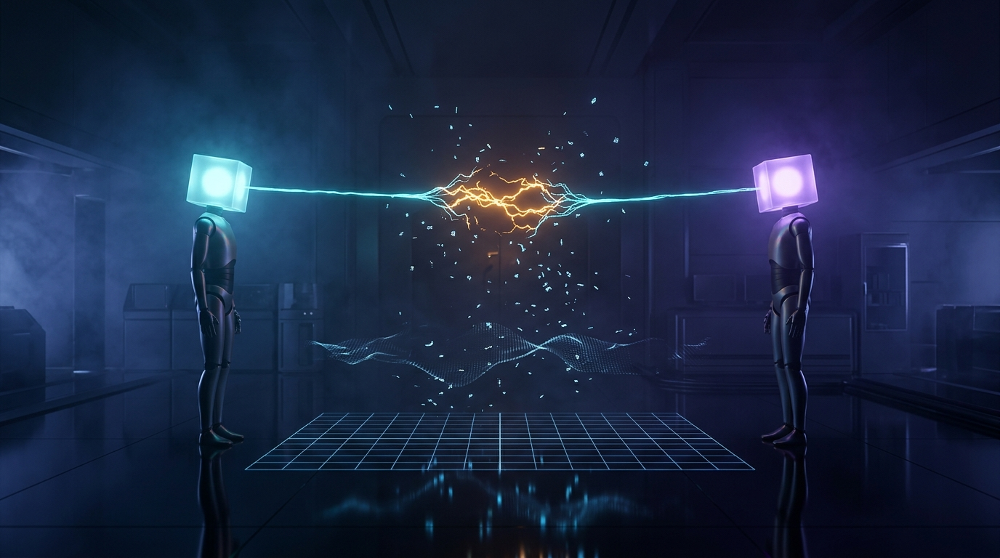
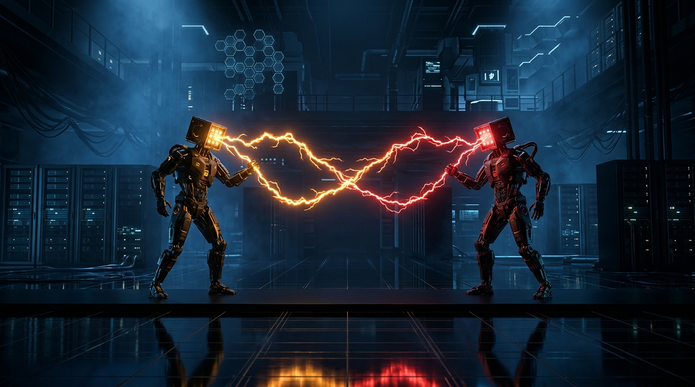

# The Dilemma Experiment: Can Cooperation Survive?

## Episode 3 — Noise & Forgiveness



### Opening question

In Episodes 1 and 2, we proved that reciprocal trust can survive against raw exploitation and build an interconnected society. 

Under round-robin tournament conditions, Robert Axelrod's famous reciprocal rule—**Tit-for-Tat**—consistently outperformed pure predators by cultivating mutual cooperation.

> But there was a hidden assumption in our laboratory.
>
> Episodes 1 and 2 took place in a pristine computational vacuum.
>
> Every intended action was transmitted with 100% fidelity. If an agent chose to cooperate, cooperation was executed. If an agent intended to defect, defection was observed.

In the real world, **communication is never lossless**.

In distributed systems, packets drop and timeouts occur. In economic markets, contracts are misinterpreted. In human teams and international diplomacy, innocent remarks are taken as hostile offenses.

What happens when you introduce even a **2% transmission glitch** into game theory?

Can reciprocal cooperation still survive when an ally's hand accidentally trembles? Or does a single misunderstanding trigger an endless death spiral of mutual retaliation?

---

### The mechanics of noise (ADR-015)

In game theory literature, this problem was first formalized by Nobel laureate Reinhard Selten in 1975 as the **"Trembling Hand"** problem, and later analyzed by Robert Axelrod, Douglas Dion, Martin Nowak, and Karl Sigmund.

To model imperfect reality in our engine without compromising architecture, we established [ADR-015: Communication and Environmental Noise](../adr/015-communication-and-environmental-noise.md).

```text
+-------------------------------------------------------+
|                       Match                           |
|       (Channel Noise Rate: 0.0 <= epsilon <= 1.0)     |
+---------------------------+---------------------------+
                            |
           +----------------+----------------+
           |                                 |
           v                                 v
+-----------------------+       +-----------------------+
|  Agent 1: Strategy    |       |  Agent 2: Strategy    |
|  Intends: COOPERATE   |       |  Intends: COOPERATE   |
+-----------+-----------+       +-----------+-----------+
            |                               |
            v                               v
    [Channel Noise: e]              [Channel Noise: e]
    (with prob e: flip)             (with prob e: flip)
            |                               |
   *FLIPPED TO DEFECT*                      |
            |                               |
            +---------------+---------------+
                            |
                            v
+-------------------------------------------------------+
|                   PrisonersDilemma                    |
|       Resolves transmitted actions: (DEFECT, COOP)    |
|                Payoffs: (+5, 0)                       |
+---------------------------+---------------------------+
                            |
           +----------------+----------------+
           |                                 |
           v                                 v
+-----------------------+       +-----------------------+
|  Agent 1 Observes:    |       |  Agent 2 Observes:    |
|  Opponent Played COOP |       |  Opponent Played DEFECT|
+-----------------------+       +-----------------------+
```

Under **ADR-015**:
1. **Noise is Owned by the Channel**: Noise is an environmental property of `Match`, not an intrinsic attribute of individual agent strategies.
2. **Symmetric Action Inversion**: In each round, with probability $\epsilon$, an intended action is inverted (`COOPERATE` $\leftrightarrow$ `DEFECT`).
3. **Actions Govern Outcomes**: The game rules engine resolves payoffs based on *transmitted* actions. Opponents observe the action that arrived through the wire, because in reality, you cannot read another agent's internal intent.
4. **Auditability in `Round`**: Every `Round` record immutably captures both `first_intended_action` and `first_action`, providing full traceability for analytics.

---

### The catastrophic collapse of zero-tolerance

When we introduced a modest 2% noise rate ($\epsilon = 0.02$) into repeated matches, the pristine champions of Episode 2 suffered catastrophic breakdown.

#### 1. Grim Trigger: The Unforgiving Death Sentence

Grim Trigger cooperates until its counterpart defects once, after which it locks into permanent defection forever.

Against an unconditional Altruist (`AlwaysCooperate`), Grim Trigger scored 150 points across 50 clean rounds ($+3$ every round).

Under 2% noise, in round 3, the channel flipped Altruist's cooperation into defection. 

Grim Trigger's fatal flaw immediately triggered: **zero forgiveness**. 

For the remaining 47 rounds, Grim Trigger defected relentlessly, harvesting $+5$ while Altruist absorbed $0$. When paired against another reciprocal agent, both locked into mutual defection ($+1/+1$), permanently collapsing social welfare.

> **The Zero-Tolerance Paradox**: In a noisy world, unforgiving perfectionism turns an innocent transmission error into permanent social ruin.

---

#### 2. Tit-for-Tat: The Retaliatory Echo Trap



The breakdown of classic Tit-for-Tat is even more insidious. 

Because Tit-for-Tat mirrors whatever its opponent did on the prior round, a single flipped bit triggers an alternating **Echo Vendetta Cycle** ($CD \leftrightarrow DC$):

```text
Round 1-4:  [Agent Alpha: C] <──────────────> [Agent Beta: C]    --> Mutual Trust (+3 / +3)
                   |                                  |
Round 5:    [Alpha: Intends C]                        |
                   | (⚡ 2% Noise Inversion)          |
                   v                                  |
            [Alpha: Plays D] ──(+5 vs 0)────────────> [Beta: Plays C]
                   |                                  |
Round 6:           | <──────────(Beta retaliates)──── [Beta: Plays D]
            [Alpha: Plays C] <──(0 vs +5)─────────────┘
                   |
Round 7:    [Alpha: Retaliates] ────────────────────> [Beta: Plays C]
            [Alpha: Plays D] ───(+5 vs 0)───────────> |
                   |                                  |
            ========================================================
            RESULT: Endless Alternating Vendetta (CD <-> DC) Forever!
            ========================================================
```

| Round | Alpha (TFT) | Beta (TFT) | Channel Status | Payoff | Consequence |
| :---: | :---: | :---: | :--- | :---: | :--- |
| **R1–4** | `COOPERATE` | `COOPERATE` | Clean transmission | `+3 / +3` | Stable mutual cooperation |
| **R5** | **`DEFECT`** | `COOPERATE` | **⚡ Noise Flip (Alpha C ➔ D)** | `+5 / 0` | Beta feels betrayed |
| **R6** | `COOPERATE` | **`DEFECT`** | Beta retaliates against R5 | `0 / +5` | Alpha feels betrayed |
| **R7** | **`DEFECT`** | `COOPERATE` | Alpha retaliates against R6 | `+5 / 0` | The feud echoes back! |
| **R8+** | `C ⇄ D` | `D ⇄ C` | Alternating Vendetta | `+2.5 avg` | Trust permanently broken |

In a 50-round duel between two Tit-for-Tat agents under 2% noise:
- Mutual cooperation occurred in **only 9 rounds**.
- The remaining **41 rounds** were consumed by an alternating retaliation feud.
- Average payoff plummeted from **3.0 points/round** to an unstable **2.5 points/round**. If a second noise event strikes during an echo cycle, it frequently collapses them into mutual defection ($DD$, 1.0 point/round).

---

### The mathematical antidotes (ADR-016)

To survive in imperfect environments, agents must evolve beyond rigid mirroring. Under [ADR-016: Noise-Resilient Forgiving Strategies](../adr/016-noise-resilient-forgiving-strategies.md), we introduced three distinct paradigms of resilience:

#### 1. Generous Tit-for-Tat (`GenerousTitForTatStrategy`)

Proposed by Axelrod & Dion (1988) and Nowak & Sigmund (1992):
- Starts with `COOPERATE`.
- If the opponent cooperated on the previous round, it cooperates.
- If the opponent defected, it does not retaliate automatically. Instead, it **forgives with probability $q$**, offering an unprovoked olive branch:
  $$q = \min\left(1 - \frac{T - R}{R - S}, \frac{R - P}{T - P}\right)$$
  For standard payoffs ($T=5, R=3, P=1, S=0$), $q = \min(1 - \frac{2}{3}, \frac{2}{4}) = \frac{1}{3} \approx 33.3\%$.

```python
class GenerousTitForTatStrategy(Strategy):
    """Cooperates initially; forgives defection with probability q."""

    def __init__(self, forgiveness_probability: float = 1 / 3, seed: int | None = None) -> None:
        self._forgiveness_probability = forgiveness_probability
        self._random = random.Random(seed)
        self._opponent_last_actions: dict[str, Action] = {}

    def choose_action(self, context: DecisionContext) -> Action:
        last = self._opponent_last_actions.get(context.opponent_id)
        if last is None or last == Action.COOPERATE:
            return Action.COOPERATE

        # Opponent defected: extend olive branch with probability q
        if self._random.random() < self._forgiveness_probability:
            return Action.COOPERATE
        return Action.DEFECT
```

When Generous Tit-for-Tat played Tit-for-Tat under 2% noise, the single glitch was forgiven in round 3. Mutual cooperation was maintained for **49 out of 50 rounds**.

---

#### 2. Tit-for-Two-Tats (`TitForTwoTatsStrategy`)

A strategy based on bounded patience:
- Cooperates on rounds 1 and 2.
- Retaliates with `DEFECT` if and only if the opponent defected on **both of the last two consecutive rounds**.

```python
class TitForTwoTatsStrategy(Strategy):
    """Cooperate unless the opponent defected twice in succession."""

    def choose_action(self, context: DecisionContext) -> Action:
        history = self._opponent_history[context.opponent_id]
        if len(history) >= 2 and history[-1] == Action.DEFECT and history[-2] == Action.DEFECT:
            return Action.DEFECT
        return Action.COOPERATE
```

An isolated transmission error is completely absorbed as a single isolated defection, preventing the echo cycle from ever starting.

---

#### 3. Win-Stay, Lose-Shift (`WinStayLoseShiftStrategy` / Pavlov)

Discovered by Martin Nowak and Karl Sigmund in 1993:
- Does not operate on memory of morality, but on **reinforcement reflex**:
  - **Win** (payoff was satisfying: $CC \to +3$ or $DC \to +5$): **STAY** with the same action.
  - **Lose** (payoff was unsatisfying: $CD \to 0$ or $DD \to +1$): **SHIFT** to the opposite action.

```text
Round 1:   [Pavlov Alpha: C] <───────────────────> [Pavlov Beta: C]   --> Win! Both STAY on C
                  |                                       |
Round 2:   [Alpha: Intends C]                             |
                  | (⚡ Noise Inversion)                  |
                  v                                       |
           [Alpha: Plays D] ──────(+5 vs 0)─────────────> [Beta: Plays C]
                  |                                       |
                  | Alpha: got +5 (Win!) --> STAY on D    | Beta: got 0 (Loss!) --> SHIFT to D
                  v                                       v
Round 3:   [Alpha: Plays D] <─────(+1 vs +1)────────────> [Beta: Plays D]
                  |                                       |
                  | Alpha: got +1 (Loss!) --> SHIFT to C  | Beta: got +1 (Loss!) --> SHIFT to C
                  v                                       v
Round 4:   [Alpha: Plays C] <─────(+3 vs +3)────────────> [Pavlov Beta: C]
                  |                                       |
           =======================================================================
           RESULT: ✨ HEALED! Restored to Mutual Cooperation in exactly 2 rounds!
           =======================================================================
```

| Round | Alpha Decision | Beta Decision | Executed Actions | Payoffs | Alpha Reflex | Beta Reflex | Outcome |
| :---: | :--- | :--- | :---: | :---: | :--- | :--- | :--- |
| **R1** | `COOPERATE` | `COOPERATE` | `C / C` | `+3 / +3` | Satisfied ($\ge 3$) ➔ **STAY** | Satisfied ($\ge 3$) ➔ **STAY** | Mutual Trust |
| **R2** | `COOPERATE` *(flipped)* | `COOPERATE` | **`D / C`** | `+5 / 0` | Got $+5$ (Win!) ➔ **STAY on D** | Got $0$ (Loss!) ➔ **SHIFT to D** | ⚡ Noise Glitch |
| **R3** | Stay on `D` | Shift to `D` | `D / D` | `+1 / +1` | Got $+1$ (Loss!) ➔ **SHIFT to C** | Got $+1$ (Loss!) ➔ **SHIFT to C** | Mutual Punishment |
| **R4** | Shift to `C` | Shift to `C` | **`C / C`** | `+3 / +3` | Got $+3$ (Win!) ➔ **STAY on C** | Got $+3$ (Win!) ➔ **STAY on C** | **✨ Fully Healed!** |

Pavlov possesses a unique property: **it self-heals after noise against cooperative partners in exactly two rounds**. Furthermore, unlike naive cooperators, if it discovers an opponent is a sucker (`AlwaysCooperate`), it shifts to exploitation and stays there.

---

### Empirical Findings: 0% vs 2% Micro-Dynamics

We ran 50-round duels across key pairs under clean conditions ($\epsilon=0\%$) versus noisy conditions ($\epsilon=2\%$):

| Pairwise Interaction (50 Rnds) | Clean Coop Rnds | Noisy Coop Rnds | Asymmetric Rnds | Observed Dynamic |
| :--- | :--- | :--- | :--- | :--- |
| **`TitForTat vs TitForTat`** | 50 | **9** | **41** | **Echo Spiral**: 1 single glitch caused 41 alternating $CD \leftrightarrow DC$ vendetta rounds. |
| **`GrimTrigger vs Altruist`** | 50 | **9** | **41** | **Fatal Breakdown**: Glitch in round 3 locked Grim into 41 rounds of permanent defection. |
| **`GenerousTFT vs TitForTat`** | 50 | **49** | **1** | **Resilient Healing**: Olive branch absorbed the error in 1 round; mutual cooperation restored. |
| **`Pavlov vs Pavlov`** | 50 | **47** | **2** | **Self-Correction**: Self-healed back to $CC$ within 2 rounds ($CD \to DD \to CC$). |

---

### The 8-Archetype Tournament under 5% Noise

To see how these dynamics scale to an entire society, we conducted a round-robin tournament of 8 archetypes across 28 matches (1,400 total rounds) at $\epsilon = 0.05$ (5% noise):

```text
================================================================================
TOURNAMENT LEADERBOARD COMPARISON: 0% NOISE vs 5% NOISE
================================================================================
AGENT            | 0% RANK | 0% SCORE | 5% RANK | 5% SCORE | SCORE DELTA
--------------------------------------------------------------------------------
GrimTrigger      | #1      | 964      | #1      | 896      | -68
Predator         | #6      | 846      | #2      | 867      | +21
TitForTat        | #2      | 910      | #3      | 799      | -111
Random           | #8      | 783      | #4      | 785      | +2
TitForTwoTats    | #3      | 893      | #5      | 775      | -118
Pavlov_WSLS      | #5      | 864      | #6      | 745      | -119
GenerousTFT      | #4      | 883      | #7      | 739      | -144
Altruist         | #7      | 825      | #8      | 661      | -164
================================================================================
```

#### Key Insights from the Data:

1. **The Predator Surge**:
   In Episode 2, pure predators finished near the bottom of the society because reciprocal agents isolated them. Under 5% noise, `Predator` surged from **Rank #6 to Rank #2 (+21 points)**. Why? Because when noise breaks down trust between cooperative agents, the entire cooperative dividend drops, allowing pure exploitation to exploit the chaos.
2. **The Fragility of Rigid Reciprocity**:
   Classic `TitForTat` dropped **111 points**, suffering heavily from mutual echo traps against other retaliatory agents.
3. **The Necessity of Environmental Calibration**:
   While Grim Trigger won the point tally by exploiting suckers and shutting down everyone else, it devastated the society's overall cooperation rate, collapsing it from over 75% down to **52.2%**.

---

### What Episode 3 Can Actually Do

Episode 3 is fully implemented, verified with 119 passing unit tests, and available in the repository.

Here is what the simulation engine now supports:
- **Configurable Channel Noise**: Run matches and tournaments with arbitrary noise probabilities $\epsilon \in [0.0, 1.0]$.
- **Intended vs. Transmitted Action Auditing**: Full inspectability of true agent decisions versus noisy channel execution.
- **Three New Resilient Strategies**: `GenerousTitForTatStrategy`, `TitForTwoTatsStrategy`, and `WinStayLoseShiftStrategy`.
- **Reproducible Deterministic Randomness**: All noise evaluations and stochastic strategies use explicit simulation-owned seeds per ADR-003.
- **Interactive Terminal Demonstration**: Run the live 4-act screencast CLI:
  ```bash
  uv run python experiments/episode_03/demo_noise_cli.py
  ```
- **Deterministic Test Suite**: Zero-mock verification passing in 0.20 seconds:
  ```bash
  uv run pytest
  ```

---

### Episode 3 Isn't the Finished World

> Episode 3 showed us how trust shatters under miscommunication—and how forgiveness heals it.
>
> But our population of agents is still static.

In our current tournaments, agents cannot reproduce, die, or adapt over generations. The population distribution is fixed by the experimenter.

In the natural world and economic markets, **strategies that generate wealth multiply, while unsuccessful strategies go extinct**.

### What's Next: Episode 4 — Natural Selection & Evolution

In **Episode 4**, we will introduce **Replicator Dynamics and Evolutionary Simulation**:
- **Generational Reproduction**: Strategies reproduce proportionally to their fitness and tournament score.
- **Ecological Extinction**: Can predators drive altruists to extinction?
- **The Forgiveness Takeover**: Can a tiny cluster of forgiving reciprocal agents invade and conquer a world of pure defectors?

---

### A note from the builder

*The Dilemma Experiment is built manually, incrementally, and transparently.*

*Every architectural choice is documented via Architecture Decision Records (ADRs under `docs/adr/`), verified with zero-mock behavioral unit tests, and committed with conventional commit history.*

*Follow the project development on GitHub: [synthex-labs-hq/the-dilemma-experiment](https://github.com/synthex-labs-hq/the-dilemma-experiment).*
