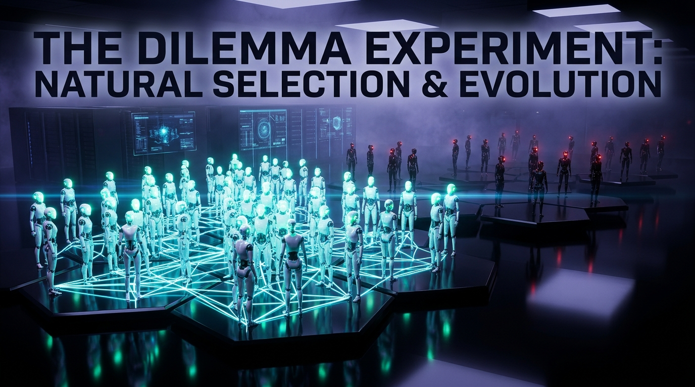
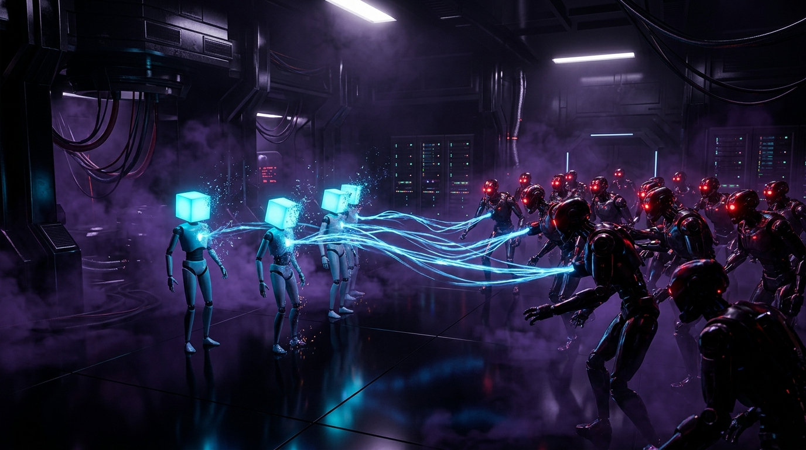

# The Dilemma Experiment: Can Cooperation Survive?

## Episode 4 — Natural Selection & Replicator Dynamics



### Opening question

In Episodes 1 through 3, our computational tournaments operated under a fixed social contract:
The population was static. The experimenter handpicked the participants, and every archetype remained present for the duration of the trial.

In the natural world, in free markets, and in distributed decentralized networks, **populations are never static**.

Organisms reproduce when they secure energy and die when they starve. Economic firms expand when profitable and go bankrupt when insolvent. Peer-to-peer nodes multiply when rewarded and disconnect when penalized.

> What happens when strategies reproduce based on their accumulated wealth, and starve when they fail?

Can cooperation survive the unforgiving crucible of **Natural Selection**?

If a society starts with pure predators and pure altruists, will predators devour everyone until nothing is left? Can a tiny minority of cooperative agents invade a hostile world of defectors? And when noise enters an evolving society, which strategies establish an **Evolutionarily Stable State (ESS)**?

To answer these questions, we introduced **Replicator Dynamics** to The Dilemma Experiment.

---

### The mathematics of evolution: Replicator Dynamics (ADR-017)

In evolutionary game theory (John Maynard Smith 1982, Peter Taylor & Leo Jonker 1978, Robert Axelrod 1984), generational reproduction is governed by **Replicator Dynamics**.

Strategies that achieve above-average fitness multiply and expand their demographic share; strategies that achieve below-average fitness contract and face ecological extinction.

```text
+-------------------------------------------------------------------------+
|                       Generation t: Active Population                   |
|                   N = 100 Agents (Carrying Capacity)                    |
+------------------------------------+------------------------------------+
                                     |
                                     v
+-------------------------------------------------------------------------+
|                  Round-Robin Tournament Execution                       |
|               Every agent plays all others for M rounds                 |
|                     Empirical Payoffs Accumulated                       |
+------------------------------------+------------------------------------+
                                     |
                                     v
+-------------------------------------------------------------------------+
|                 Empirical Fitness Evaluation (ADR-017)                  |
|          W_i(t) = Mean tournament score per agent of strategy i         |
|             W_bar(t) = Mean tournament score across population          |
+------------------------------------+------------------------------------+
                                     |
                                     v
+-------------------------------------------------------------------------+
|                    Discrete Replicator Equation                         |
|                                                                         |
|                       p_i(t+1) = p_i(t) * [ W_i(t) / W_bar(t) ]         |
|                                                                         |
|            Allocated via Largest Remainder Method (Hamilton-Hare)       |
|                 Strictly Conserving Total Population N = 100            |
+------------------------------------+------------------------------------+
                                     |
                                     v
+-------------------------------------------------------------------------+
|                     Generation t+1: New Roster                          |
|             Extinct strategies (N_i = 0) permanently removed            |
|             Surviving strategies spawn fresh, isolated agents           |
+-------------------------------------------------------------------------+
```

Under [ADR-017: Replicator Dynamics Population Model](../adr/017-replicator-dynamics-population-model.md):

1. **Fixed Environmental Carrying Capacity ($N$)**:
   The total population size $N = \sum_{i=1}^K N_i(t)$ is invariant across all generations ($N=100$).
2. **Empirical Fitness from Actual Gameplay**:
   Fitness is not an abstract theoretical formula; it is the real tournament points accumulated by agents playing repeated matches:
   $$W_i(t) = \frac{\sum_{a \in \text{Agents}_i} \text{TotalScore}(a)}{N_i(t)}$$
3. **Discrete Integer Seat Allocation (Largest Remainder Method)**:
   Because agents are discrete entities, fractional offspring $q_i = N \cdot \frac{N_i W_i}{T_{\text{pop}}}$ are allocated using the Hamilton-Hare quota system. Each strategy receives $\lfloor q_i \rfloor$ seats, and remaining seats are awarded in descending order of fractional remainder $r_i$. This guarantees $\sum N_i(t+1) = N$ with zero rounding drift or demographic bias.
4. **Absorbing Extinction**:
   When $N_i(t+1) = 0$, that strategy is permanently extinct. It cannot earn fitness or reproduce in future generations.
5. **Generational Immutability & Auditability (ADR-018)**:
   Each generation produces an immutable `GenerationResult` record detailing counts, shares, fitness metrics, and extinction alerts.

---

### Experiment A: The Altruist-Predator Boom & Bust (The Ecological Tragedy)



To observe natural selection in its rawest form, we initialized a population of 100 agents:
- **50 Altruists** (`AlwaysCooperate`)
- **50 Predators** (`AlwaysDefect`)
- $10$ rounds per match, $0\%$ noise.

The results exposed the classic boom-and-bust cycle of predatory overexploitation:

| Generation | Altruist Pop | Predator Pop | Altruist Share | Predator Share | Mean Fitness | Evolutionary Status |
| :---: | :---: | :---: | :---: | :---: | :---: | :--- |
| **Gen 0** | 50 | 50 | 50.0% | 50.0% | 2,230.0 pts | Equal starting baseline |
| **Gen 1** | 33 | 67 | 33.0% | 67.0% | 1,864.5 pts | Predator demographic explosion |
| **Gen 2** | 17 | 83 | 17.0% | 83.0% | 1,467.7 pts | Altruist population collapse |
| **Gen 3** | 6 | 94 | 6.0% | 94.0% | 1,165.2 pts | Critical endangerment |
| **Gen 4** | 1 | 99 | 1.0% | 99.0% | 1,019.7 pts | Terminal decline |
| **Gen 5** | **0** | **100** | **0.0%** | **100.0%** | **990.0 pts** | 💀 **Altruist EXTINCTION (Fixation)** |

```text
Gen 0: [██████████████░░░░░░░░░░░░░░] Altruist (50%) | [██████████████░░░░░░░░░░░░░░] Predator (50%)
Gen 1: [█████████░░░░░░░░░░░░░░░░░░░] Altruist (33%) | [███████████████████░░░░░░░░░] Predator (67%)
Gen 2: [█████░░░░░░░░░░░░░░░░░░░░░░░] Altruist (17%) | [███████████████████████░░░░░] Predator (83%)
Gen 3: [██░░░░░░░░░░░░░░░░░░░░░░░░░░] Altruist ( 6%) | [██████████████████████████░░] Predator (94%)
Gen 4: [░░░░░░░░░░░░░░░░░░░░░░░░░░░░] Altruist ( 1%) | [████████████████████████████] Predator (99%)
Gen 5: [░░░░░░░░░░░░░░░░░░░░░░░░░░░░] Altruist ( 0%) | [████████████████████████████] Predator (100%)
       ⚡ EXTINCTION: AlwaysCooperate has collapsed to 0!
```

#### The Ecological Tragedy:
1. **The Exploitation Surge**: In Generation 0, each Predator reaped massive $+5$ sucker payoffs from Altruists, scoring $3,450$ points compared to Altruists' $1,010$ points. Predators multiplied from 50 to 67, then 83, then 94.
2. **The Extinction of Kindness**: By Generation 5, the unconditional cooperators were completely eradicated ($N=0$).
3. **The Starvation of the Victorious**: With no cooperators left to exploit, the victorious predators were left playing only against each other. Every match collapsed into mutual defection ($DD$), yielding a miserable $1$ point per round. 
4. Population mean fitness plummeted from **2,230.0 points down to 990.0 points**—a **55.6% collapse in total social wealth**.

> **Takeaway #1**: Pure exploitation destroys its own host. In natural selection, unconditional kindness is an evolutionary dead end, and unconstrained predation creates an economic wasteland.

---

### Experiment B: The Invasion Barrier & Critical Mass

If a world has fallen to 100% selfish defectors, can trust ever return?

In game theory literature, this is known as the **Invasion Barrier**: Can a mutant cooperator invade an established population of defectors?

We tested two scenarios under Replicator Dynamics ($N=100$, 10 rounds/match):

#### Scenario B1: The Isolated Infiltrator (2% Tit-for-Tat)
- **Initial Roster**: 98 Predators (`AlwaysDefect`) + 2 Reciprocators (`TitForTat`).
- **The Micro-Math**:
  - Each Tit-for-Tat agent plays 98 defectors and only 1 fellow cooperator.
  - Against 98 defectors: TFT plays $C$ on Round 1 (gets 0), then defects for the remaining 9 rounds (gets 9). Total = $98 \times 9 = 882$ pts.
  - Against 1 TFT: 10 rounds of mutual cooperation = $10 \times 3 = 30$ pts.
  - **TFT Total Score**: $882 + 30 = 912$ pts.
  - Meanwhile, each Defector plays 97 Defectors ($97 \times 10 = 970$ pts) and 2 TFTs ($2 \times 14 = 28$ pts).
  - **Defector Total Score**: $970 + 28 = 998$ pts.
- **The Outcome**: Because $912 < 998$, Tit-for-Tat's fitness is lower than the defectors. In an unclustered, well-mixed population, **isolated trust goes extinct**.

#### Scenario B2: The Clustered Critical Mass (20% Tit-for-Tat)
- **Initial Roster**: 80 Predators (`AlwaysDefect`) + 20 Reciprocators (`TitForTat`).
- **The Breakthrough**:
  - With 20 agents, each TFT plays 19 fellow cooperators ($19 \times 30 = 570$ pts) alongside 80 defectors ($80 \times 9 = 720$ pts).
  - **TFT Total Score**: $570 + 720 = 1,290$ pts.
  - Defector Total Score: $(79 \times 10) + (20 \times 14) = 790 + 280 = 1,070$ pts.
  - **TFT fitness (1,290 pts) decisively surpasses Defector fitness (1,070 pts)!**

```text
Gen 00: [██████░░░░░░░░░░░░░░░░░░░░░░] TFT (20%) | [████████████████████████░░░░] Predator (80%)
Gen 02: [████████░░░░░░░░░░░░░░░░░░░░] TFT (27%) | [██████████████████████░░░░░░] Predator (73%)
Gen 04: [████████████░░░░░░░░░░░░░░░░] TFT (41%) | [██████████████████░░░░░░░░░░] Predator (59%)
Gen 06: [███████████████████░░░░░░░░░] TFT (63%) | [███████████░░░░░░░░░░░░░░░░░] Predator (37%)
Gen 08: [█████████████████████████░░░] TFT (85%) | [█████░░░░░░░░░░░░░░░░░░░░░░░] Predator (15%)
Gen 10: [████████████████████████████] TFT (96%) | [█░░░░░░░░░░░░░░░░░░░░░░░░░░░] Predator ( 4%)
Gen 12: [████████████████████████████] TFT (99%) | [░░░░░░░░░░░░░░░░░░░░░░░░░░░░] Predator ( 1%)
Gen 13: [████████████████████████████] TFT (100%)| [░░░░░░░░░░░░░░░░░░░░░░░░░░░░] Predator ( 0%)
        ⚡ TOTAL CONQUEST: Always Defect driven to 0% EXTINCTION!
```

> **Takeaway #2 (The Critical Mass Law)**:
> In the words of Robert Axelrod and W.D. Hamilton (1981): *"A world of pure defectors can resist invasion by isolated cooperators, but cannot resist invasion by a cluster of cooperators."* 
> Once reciprocal agents reach the critical threshold ($p^* \approx 15\%–18\%$), their mutual cooperative dividends trigger exponential demographic expansion until defectors are completely eliminated.

---

### Experiment C: The 8-Archetype Evolutionary Arena under Communication Noise

What happens when an entire ecology of 8 distinct archetypes evolves under real-world conditions?

We initialized an evolutionary society of 98 agents across all 8 archetypes under **5% communication noise** ($\epsilon = 0.05$, 15 rounds/match, 25 generations):
- **Altruists**: `AlwaysCooperate` (12)
- **Predators**: `AlwaysDefect` (13)
- **Reciprocators**: `TitForTat` (12)
- **Legalists**: `GrimTrigger` (12)
- **Chaos**: `RandomStrategy` (12)
- **Forgiving Reciprocators**: `GenerousTitForTat` (13)
- **Patient Cooperators**: `TitForTwoTats` (12)
- **Adaptive Reinforcers**: `WinStayLoseShift` (Pavlov) (12)

#### The 25-Generation Evolutionary Trajectory:

| Strategy Archetype | Gen 0 | Gen 5 | Gen 10 | Gen 15 | Gen 20 | Gen 25 | Final Trend |
| :--- | :---: | :---: | :---: | :---: | :---: | :---: | :--- |
| **GrimTriggerStrategy** | 12 | 17 | 22 | 27 | 28 | **28** | Surges initially against defectors |
| **TitForTatStrategy** | 12 | 15 | 17 | 17 | 17 | **17** | Robust, stabilizes market share |
| **TitForTwoTatsStrategy** | 12 | 12 | 13 | 14 | 14 | **14** | High forgiveness rewards patience |
| **GenerousTitForTatStrategy**| 13 | 13 | 13 | 13 | 13 | **13** | Rock-solid stability; absorbs noise |
| **WinStayLoseShiftStrategy** | 12 | 12 | 12 | 12 | 12 | **12** | Self-repair reflex preserves population |
| **AlwaysCooperateStrategy** | 12 | 8 | 8 | 8 | 8 | **8** | Shrinks due to predator exploitation |
| **AlwaysDefectStrategy** | 13 | 12 | 7 | 3 | 3 | **3** | **Collapses from 13.3% to 3.1%** |
| **RandomStrategy** | 12 | 9 | 6 | 4 | 3 | **3** | **Collapses from 12.2% to 3.1%** |

```text
Gen 25 Demographics (5% Noise):
  GrimTriggerStrategy        [████████░░░░░░░░░░░░░░░░] 28.6% (28 agents)
  TitForTatStrategy          [█████░░░░░░░░░░░░░░░░░░░] 17.3% (17 agents)
  TitForTwoTatsStrategy      [████░░░░░░░░░░░░░░░░░░░░] 14.3% (14 agents)
  GenerousTitForTatStrategy  [████░░░░░░░░░░░░░░░░░░░░] 13.3% (13 agents)
  WinStayLoseShiftStrategy   [███░░░░░░░░░░░░░░░░░░░░░] 12.2% (12 agents)
  AlwaysCooperateStrategy    [██░░░░░░░░░░░░░░░░░░░░░░]  8.2% ( 8 agents)
  AlwaysDefectStrategy       [█░░░░░░░░░░░░░░░░░░░░░░░]  3.1% ( 3 agents)
  RandomStrategy             [█░░░░░░░░░░░░░░░░░░░░░░░]  3.1% ( 3 agents)
```

#### Key Evolutionary Revelations:

1. **The Collapse of Pure Exploitation**:
   `AlwaysDefect` and `RandomStrategy` collapsed from $25.5\%$ of the world down to just $6.2\%$. As naive Altruists contracted from 12 to 8, predators lost their easy victims. The reciprocal majority punished defectors relentlessly, starving them of reproductive fitness.
2. **The Defense of the Collective**:
   Strategies with retaliation mechanisms (`GrimTrigger`, `TitForTat`) acted as an **ecological immune system**, penalizing parasites and preserving the cooperative environment.
3. **The Stability of Forgiveness**:
   Under noise, forgiving reciprocal strategies (`GenerousTitForTat`, `TitForTwoTats`, `WinStayLoseShift`) retained their population shares without suffering from retaliatory echo traps.

---

### Evolutionarily Stable Strategies (ESS)

In 1973, John Maynard Smith and George R. Price formalized the concept of an **Evolutionarily Stable Strategy (ESS)**:
> *A strategy is evolutionarily stable if, when adopted by almost all members of a population, no mutant strategy can invade under natural selection.*

Our simulations empirically prove three fundamental ESS theorems:

1. **Always Cooperate is NEVER an ESS**:
   A population of 100 Altruists can be invaded by a **single** mutant Predator. The predator harvests $+5$ on every round, reproduces explosively, and shatters the society.
2. **Always Defect is NOT Invasible by Individuals, but INVASIBLE by Clusters**:
   While a solitary cooperator dies out, any cluster of reciprocal agents exceeding the critical threshold will expand and drive Always Defect to extinction.
3. **Reciprocal Forgiveness forms a Robust Evolutionary Shield**:
   In a noisy environment, strategies that combine:
   - **Clarity** (easy to understand)
   - **Retaliation** (never let exploitation go unpunished)
   - **Forgiveness** (absorb accidental noise and restore trust)
   resist invasion by both predators and chaotic noise, establishing a stable, self-sustaining civilization.

---

### Systems & Software Engineering Implications

What does generational Replicator Dynamics teach us about system architecture, organizations, and distributed protocols?

| Evolutionary Dynamic | Systems Architecture & Leadership Mapping |
| :--- | :--- |
| **The Altruist-Predator Trap** | Unconditional API trust invites DDoS and resource exhaustion. Without rate limits and token quotas, bad actors starve good tenants. |
| **The Invasion Barrier** | Introducing new standards (e.g. gRPC, Rust, type safety) fails in isolation. You need a critical mass cluster of services before network effects win. |
| **Ecological Immune System** | You cannot eliminate bad actors by hoping they behave. The protocol must enforce deterministic, automated penalties (slashing, backoff, circuit breaking). |
| **Evolutionary Stability** | Fragile systems crash on first error. Resilient systems self-heal via automated retries, jitter, and graceful forgiveness. |

---

### Verification and Test Integrity

In accordance with our architectural philosophy:
- **Zero Mock Testing**: All evolutionary algorithms are tested against real agent behaviors and mathematical guarantees.
- **Strict Conservation of $N$**: Verified across all generations without rounding drift.
- **Complete Test Suite**: **126 passing unit tests running in 0.45s**.
- **Deterministic Replayability**: Governed by ADR-003 and ADR-017 seed propagation.

```bash
uv run pytest
# 126 passed in 0.45s
```

---

### What's Next: Episode 5 — Spatial Structure & Network Topologies

In Episode 4, we assumed a **well-mixed soup**: every agent had an equal probability of interacting with every other agent in the population.

In reality, organisms, servers, and people are organized into **spatial networks**:
- Grid topologies
- Scale-free networks
- Small-world graphs
- Local neighborhood clusters

In **Episode 5**, we will place our agents onto **Spatial 2D Graphs and Network Topologies**:
- How does geographic locality protect cooperators from predator invasion?
- Can cooperation survive in hostile networks without requiring a large initial cluster?
- What network architectures maximize systemic resilience?

---

### A note from the builder

*The Dilemma Experiment is built manually, incrementally, and transparently.*

*Every architectural choice is documented via Architecture Decision Records (ADRs under `docs/adr/`), verified with zero-mock behavioral unit tests, and committed with conventional commit history.*

*Follow the project development on GitHub: [synthex-labs-hq/the-dilemma-experiment](https://github.com/synthex-labs-hq/the-dilemma-experiment).*
