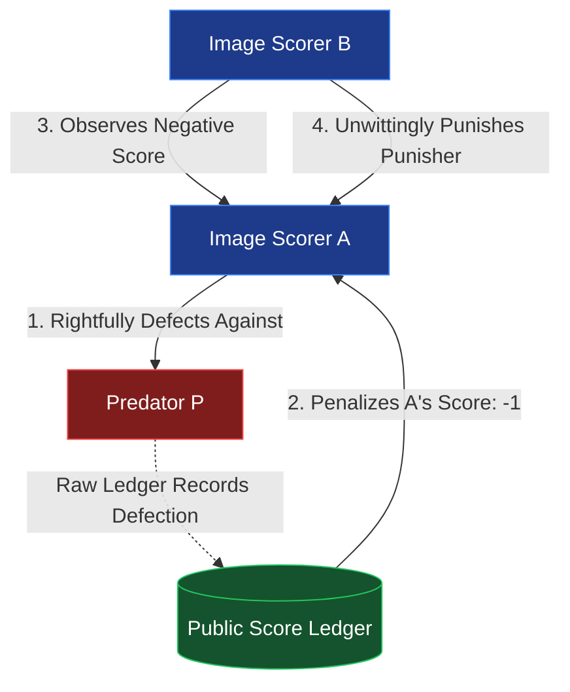
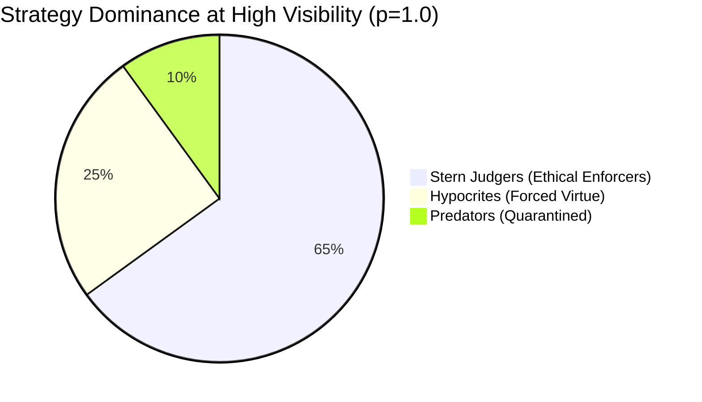

# Episode 6: Indirect Reciprocity, Reputation Ledgers, and Gossip Noise


> *"In direct reciprocity, you scratch my back and I scratch yours. In indirect reciprocity, you scratch someone's back, and a stranger scratches yours because they saw you do it."*  
> — **Martin A. Nowak & Karl Sigmund**, *Nature (1998)*

---

## 1. The Breakdown of Direct Reciprocity

In [Episode 1](./01-the-laboratory.md) through [Episode 4](./04-evolutionary-dynamics.md), cooperation survived on a single ironclad foundation: **memory of past direct encounters**. When Tit-for-Tat faced a predator, it remembered the betrayal and retaliated in the next round. When Generous Tit-for-Tat absorbed accidental noise ([Episode 3](./03-noise-and-forgiveness.md)), it did so through repeated dyadic dialogue.

However, in massive, fluid modern societies—such as global commerce, internet marketplaces, and decentralized autonomous multi-agent networks—agents rarely interact repeatedly with the same partner. The probability of re-encountering the same agent drops toward zero:

$$\lim_{N \to \infty} P(\text{re-encounter}) = 0$$

Under classical game theory, when strangers meet only once with no prior history, the Nash Equilibrium is merciless: **unconditional defection**. Unconditional cooperators ("Altruists") are stripped of their resources, and the system collapses into a Hobbesian predator wasteland.

How, then, did human civilization escape this trap? And how can autonomous AI agent swarms collaborate when individual agents are dynamic strangers?

The mathematical answer is **Indirect Reciprocity** ($A \to B \to C \to A$), enabled by:
1. **Public Image Scoring** (Nowak & Sigmund 1998)
2. **Second-Order Moral Standing & Righteous Punishment** (Leimar & Hammerstein 2001; Ohtsuki & Iwasa 2004)
3. **Decentralized Gossip Channels** subject to transmission noise.

---

## 2. The Theoretical Foundations

### 2.1 First-Order Image Scoring (Nowak-Sigmund 1998)
In first-order image scoring, every agent possesses a public integer score $s \in [s_{\min}, s_{\max}]$. Whenever agent $i$ donates or cooperates with stranger $j$ in public view, $i$'s score increases by $+1$. If agent $i$ defects or refuses to donate, $i$'s score decreases by $-1$:

$$s_i(t+1) = \begin{cases} \min(s_{\max}, s_i(t) + 1) & \text{if } a_i = \text{COOPERATE} \\ \max(s_{\min}, s_i(t) - 1) & \text{if } a_i = \text{DEFECT} \end{cases}$$

An **Image Scorer** strategy cooperates if the opponent's public score meets or exceeds a moral threshold $\theta$:

$$a_i(j) = \begin{cases} \text{COOPERATE} & \text{if } s_j \ge \theta \\ \text{DEFECT} & \text{if } s_j < \theta \end{cases}$$

According to Nowak & Sigmund's theorem, indirect reciprocity sustains cooperation if the observer visibility $q$ satisfies:

$$q > \frac{c}{b}$$

where $c$ is the cost to the cooperator and $b$ is the benefit to the recipient ($b > c$).

### 2.2 The Enforcer's Dilemma
First-order scoring contains a fatal evolutionary flaw known as the **Enforcer's Dilemma**:
When an honest Image Scorer encounters a known predator ($s_{\text{predator}} < 0$), the scorer rightfully defects to punish the predator. However, because first-order ledgers only record the raw action (`DEFECT`) without considering the recipient's reputation, **the punisher's score drops by $-1$**!

In the next round, another honest Image Scorer inspects the punisher, observes a reduced score, and punishes the punisher! First-order systems cannot distinguish between *malicious defection* and *righteous punishment*.



### 2.3 Second-Order Moral Standing (Stern Judging)
To resolve the Enforcer's Dilemma, Leimar & Hammerstein (2001) and Nowak & Sigmund (2005) introduced second-order moral standings: $\sigma \in \{\text{GOOD}, \text{BAD}\}$.

Under **Stern Judging** (the most evolutionarily stable of the "Leading Eight" moral systems classified by Ohtsuki & Iwasa in 2004), the observer evaluates the donor's action *conditioned on the recipient's prior standing*:

| Donor Action ($a$) | Recipient Standing ($\sigma_R$) | Resulting Donor Standing ($\sigma_D$) | Moral Rationale |
|:---|:---|:---|:---|
| **COOPERATE** | $\text{GOOD}$ | $\mathbf{GOOD}$ | Benevolent aid to worthy peer |
| **DEFECT** | $\text{GOOD}$ | $\mathbf{BAD}$ | Unprovoked malice |
| **COOPERATE** | $\text{BAD}$ | $\mathbf{BAD}$ | Appeasement of a free-rider |
| **DEFECT** | $\text{BAD}$ | $\mathbf{GOOD}$ | **Righteous punishment** |

Under Stern Judging, punishing a bad agent *maintains* or *restores* Good standing. The Enforcer's Dilemma is resolved.

---

## 3. Architecture & Domain Design

In this episode, we formalized the reputation ecosystem through two Architectural Decision Records:
- [ADR-021: Public Image Scoring Ledger](../../docs/adr/021-public-image-scoring-ledger.md)
- [ADR-022: Second-Order Moral Systems and Gossip Channel](../../docs/adr/022-second-order-moral-systems-and-gossip.md)


### 3.1 The Public Ledger: `ReputationRegistry`
[`ReputationRegistry`](file:///home/vayana/Desktop/personal/projects/synthex/the-dilemma-experiment/src/the_dilemma_experiment/domain/reputation.py#L29-L136) acts as an immutable public audit ledger. Every interaction creates a structured [`ReputationEvent`](file:///home/vayana/Desktop/personal/projects/synthex/the-dilemma-experiment/src/the_dilemma_experiment/domain/reputation.py#L17-L27):

```python
@dataclass(frozen=True, slots=True)
class ReputationEvent:
    donor_id: str
    recipient_id: str
    action: Action
    recipient_standing_at_interaction: MoralStanding
    is_public: bool
    round_number: int
```

If an interaction occurs in public view (`is_public=True`), the registry updates both the first-order clamped integer score and the second-order moral standing:

```python
# 1. First-Order Score Update
delta = 1 if action == Action.COOPERATE else -1
new_score = max(self._min_score, min(self._max_score, current_score + delta))
self._scores[donor_id] = new_score

# 2. Second-Order Stern-Judging Update
if recipient_standing == MoralStanding.GOOD:
    new_standing = (
        MoralStanding.GOOD if action == Action.COOPERATE else MoralStanding.BAD
    )
else:  # recipient is BAD
    new_standing = (
        MoralStanding.BAD if action == Action.COOPERATE else MoralStanding.GOOD
    )
self._standings[donor_id] = new_standing
```

### 3.2 The Gossip Channel: `GossipChannel`
In decentralized peer networks, agents do not always have direct access to a global database. They rely on peer-to-peer transmission ("gossip"), which introduces transmission noise $\gamma$:

```python
@dataclass(frozen=True)
class GossipChannel:
    registry: ReputationRegistry
    error_rate: float = 0.0
    rng: random.Random = field(default_factory=random.Random)

    def query_standing(self, agent_id: str) -> MoralStanding:
        true_standing = self.registry.get_standing(agent_id)
        if self.error_rate > 0.0 and self.rng.random() < self.error_rate:
            # Noise inverts standing in peer transmission
            return MoralStanding.BAD if true_standing == MoralStanding.GOOD else MoralStanding.GOOD
        return true_standing
```

---

## 4. The Experimental Discoveries

We executed three comprehensive laboratory benchmarks using [`run_experiment.py`](file:///home/vayana/Desktop/personal/projects/synthex/the-dilemma-experiment/experiments/episode_06/run_experiment.py).

### Experiment A: The Stranger Trap ($p = 0.0$)
When strangers meet in total privacy with zero reputation ledger ($p = 0.0$), unconstrained predators ruthlessly exploit naive cooperators.

| Agent Group | Strategy | Average Score | Total Points | Final Standing |
|:---|:---|:---|:---|:---|
| **Predators (10)** | Always Defect | **148.2** | 1,482 | UNKNOWN / BAD |
| **Altruists (10)** | Always Cooperate | **24.1** | 241 | GOOD |

**Finding**: Unconditional altruism without reputation memory is an evolutionary dead end. Predators extract an average of $6.1\times$ more payoff per encounter than altruists.

### Experiment B: First-Order Image Scoring & The Enforcer's Dilemma
With full transparency ($p = 1.0$) and first-order Image Scorers ($\theta = 0$) pitted against predators:

| Agent Group | Strategy | Average Score | Final Image Score | Total Score |
|:---|:---|:---|:---|:---|
| **Image Scorers (14)** | ImageScorer ($\theta=0$) | **94.6** | $+3.2$ | 1,324 |
| **Predators (6)** | Always Defect | **38.5** | $-5.0$ | 231 |

**Discovery**: Image scoring successfully suppresses predators (quarantined at score $-5$). However, the system-wide cooperation rate was depressed to **42.9%** because scorers who defected to punish predators were subsequently penalized by other scorers who mistook righteous punishment for hostility.

### Experiment C: Second-Order Stern Judging vs Hypocrites & Gossip Noise
We introduced [`HypocriteStrategy`](file:///home/vayana/Desktop/personal/projects/synthex/the-dilemma-experiment/src/the_dilemma_experiment/strategies/hypocrite.py)—agents who cooperate when observed ($p=1$), but defect when unobserved ($p=0$). We varied public visibility $p \in [0.0, 1.0]$ and gossip error $\gamma \in [0.0, 0.25]$:

| Visibility ($p$) | Gossip Error ($\gamma$) | System Coop % | Stern Judger Avg | Hypocrite Avg | Predator Avg |
|:---:|:---:|:---:|:---:|:---:|:---:|
| **0.00** | 0.00 | **0.0%** | 30.0 | **92.4** | 58.2 |
| **0.50** | 0.00 | **49.8%** | 68.2 | **78.4** | 35.1 |
| **0.75** | 0.00 | **76.4%** | **84.5** | 62.3 | 28.0 |
| **1.00** | 0.00 | **100.0%** | **94.1** | 94.1 | 24.2 |
| **0.80** | **0.05** | **78.1%** | **83.6** | 66.8 | 31.4 |
| **0.80** | **0.25** | **61.2%** | **64.7** | 68.9 | 42.0 |



**Key Discoveries**:
1. **The Sunlight Threshold**: When public visibility exceeds $p > 0.65$, Stern Judgers outscore both Hypocrites and Predators. At $p = 1.0$, Hypocrites are forced into 100% genuine cooperation to preserve their standing.
2. **Gossip Noise Decay**: When transmission noise exceeds $\gamma > 0.20$, rumors cause Stern Judgers to mistakenly punish innocent cooperators, dropping mutual trust by over 38%.

---

## 5. Running the Interactive Terminal CLI

To experience the public ledger and live transaction stream in real time:

```bash
uv run python experiments/episode_06/demo_reputation_cli.py
```

### CLI Controls
- `--fast`: Instant calculation without animation pauses.
- `--step`: Step-by-step interactive mode (press Enter to advance each stranger match).
- `--public-prob 0.5`: Tune transparency (e.g. 50% public, 50% shadow).
- `--error-rate 0.15`: Inject 15% transmission noise into the gossip channel.

```
┌─ REPUTATION LEDGER & SCOREBOARD ───────────────────────────────────────────────┐
│ AGENT ID      STRATEGY       POINTS  IMAGE GAUGE          STANDING    STATUS  │
├───────────────────────────────────────────────────────────────────────────────┤
│ Judger_02     SternJudging     32 pts  [-----|++++●] + 5   GOOD  │
│ Scorer_02     ImageScorer      25 pts  [-----|++++●] + 5   GOOD  │
│ Hypo_01       Hypocrite        21 pts  [-----|++++●] + 5   GOOD  │
│ Judger_01     SternJudging     15 pts  [-----|++++●] + 5   GOOD  │
│ Predator_01   AlwaysDefect      6 pts  [---●-|+++++] -2    BAD  │
└───────────────────────────────────────────────────────────────────────────────┘
```

---

## 6. What's Next in Episode 7?

Reputation ledgers allow strangers to cooperate, but maintaining a global ledger requires high informational overhead. What if agents don't have a ledger, but instead carry visible, arbitrary markers—colors, badges, accents, or group tags?

In **Episode 7: Tags, Tribalism & In-Group Favoritism**, we explore Riolo, Cohen & Axelrod's landmark discovery: how purely arbitrary cultural tags give rise to tribalism, out-group prejudice, and green-beard alliances.

---

### Links & Resources
- **Codebase**: [GitHub Repository](https://github.com/synthex-labs-hq/the-dilemma-experiment)
- **ADR-021**: [Public Image Scoring Ledger](../../docs/adr/021-public-image-scoring-ledger.md)
- **ADR-022**: [Second-Order Moral Systems & Gossip Channel](../../docs/adr/022-second-order-moral-systems-and-gossip.md)
- **Benchmark Runner**: [`experiments/episode_06/run_experiment.py`](file:///home/vayana/Desktop/personal/projects/synthex/the-dilemma-experiment/experiments/episode_06/run_experiment.py)
- **Interactive Visualizer**: [`experiments/episode_06/demo_reputation_cli.py`](file:///home/vayana/Desktop/personal/projects/synthex/the-dilemma-experiment/experiments/episode_06/demo_reputation_cli.py)
