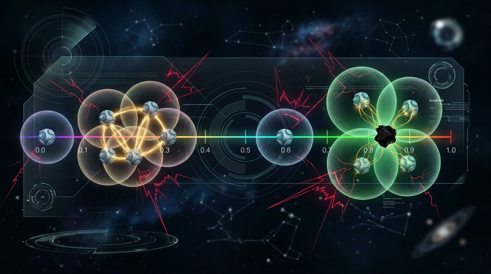
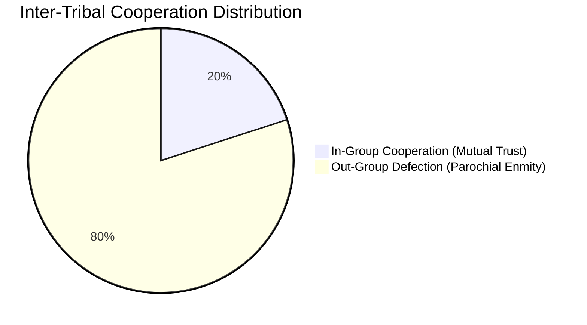

# Episode 7: Tags, Tribalism, and In-Group Favoritism


> *"Altruists with green beards will recognize each other, and will be altruistic towards each other... But what is to prevent a mutant from arising which has the green beard but does not pay the altruistic cost? It would reap all the benefits of others' altruism, and pay nothing in return."*  
> — **Richard Dawkins**, *The Selfish Gene (1976)*

---

## 1. The Mystery of Cooperation Without History or Ledgers

In our first six episodes, cooperation survived because agents possessed either:
1. **Memory of repeated dyadic interactions** (Tit-for-Tat, Generous TFT, Win-Stay Lose-Shift, Episodes 1–3).
2. **Spatial clustering** (the geography of neighbors on grids and networks, Episode 5).
3. **Public audit ledgers** (Nowak-Sigmund image scores and Stern Judging, Episode 6).

Yet, across human anthropology and animal biology, creatures routinely cooperate with complete strangers who share **no prior history**, **no shared ledger**, and **no spatial proximity**.

Instead, cooperation is triggered by arbitrary surface markers—what game theorists call **Tags**:
- In ants and honeybees, cuticular hydrocarbon scents trigger nestmate altruism and lethal hostility toward outsiders.
- In human societies, clothing, uniforms, religious emblems, linguistic dialects, and sports jerseys trigger instant, unconditional in-group cooperation—alongside suspicion or warfare toward out-groups.
- In distributed computing and cryptographic systems, identity tokens, TLS certificates, and group signatures partition actors into trusted enclaves.

How can completely arbitrary surface markers create stable cooperation? And why doesn't a "false-beard" parasite—an agent that displays the green badge but defects—immediately destroy the system?

In 2001, Rick Riolo, Michael Cohen, and Robert Axelrod published a landmark paper in *Nature* (*"Evolution of cooperation without reciprocity"*), proving that arbitrary tags and continuous tolerance thresholds solve the dilemma. In this episode, we reproduce and extend their model in code.

---

## 2. Mathematical & Theoretical Foundations

### 2.1 The Green-Beard Hypothesis (Hamilton 1964; Dawkins 1976)
William D. Hamilton first proposed that altruism could spread if a single genetic mechanism produced three distinct effects:
1. A perceptible phenotypic marker (e.g., a "green beard").
2. The ability to recognize the marker in others.
3. Altruistic behavior directed preferentially toward individuals bearing the marker.

Richard Dawkins popularized this as the **Green-Beard Effect**. However, classical evolutionary theory long considered green beards unstable: if recombination or mutation separates the *marker* gene from the *altruism* gene, a "false-beard" mutant arises—bearing the green beard but defecting. The false-beard enjoys all incoming aid while paying zero cost, driving the green-beards extinct.

### 2.2 Riolo-Cohen-Axelrod Tag & Tolerance Dynamics (Nature 2001)
Riolo, Cohen, and Axelrod solved the false-beard paradox by demonstrating that when tags and tolerance are **continuous** and **subject to independent mutation**, cooperation survives through dynamic evolutionary cycles.

Each agent possesses two continuous traits:
1. A visible surface tag $\tau \in [0.0, 1.0]$.
2. A tolerance threshold $T \ge 0.0$.

When agent $i$ encounters stranger $j$, agent $i$ computes the distance between their tags:

$$d(\tau_i, \tau_j) = |\tau_i - \tau_j|$$

Agent $i$ cooperates with $j$ if and only if the tag distance is within $i$'s tolerance:

$$a_i(j) = \begin{cases} \text{COOPERATE} & \text{if } d(\tau_i, \tau_j) \le T_i \\ \text{DEFECT} & \text{if } d(\tau_i, \tau_j) > T_i \end{cases}$$

Notice the crucial asymmetry: $i$ may cooperate with $j$ because $d \le T_i$, while $j$ defects against $i$ because $d > T_j$. Tolerance is strictly individual.

```mermaid
graph LR
    subgraph Agent I [Agent i: Tag 0.50, Tol 0.15]
    end
    subgraph Agent J [Agent j: Tag 0.60, Tol 0.05]
    end
    Agent I -->|"Dist = 0.10 <= 0.15 (COOPERATE)"| Agent J
    Agent J -->|"Dist = 0.10 > 0.05 (DEFECT)"| Agent I
    style Agent I fill:#15803d,stroke:#22c55e,color:#ffffff
    style Agent J fill:#b91c1c,stroke:#ef4444,color:#ffffff
```

### 2.3 The Evolutionary Boom-and-Bust Cycle
When agents reproduce with mutation on tags ($\mu_\tau$) and tolerance ($\mu_T$):
1. **Cluster Formation**: A mutation creates a tight cluster of agents with similar tags ($\tau \approx \tau_0$) and low tolerance. They cooperate with each other and out-earn outsiders.
2. **Tolerance Inflation**: Within the cluster, individuals with slightly higher tolerance $T$ lose nothing (since out-groups are distant) and gain from peripheral interactions. Mean tolerance drifts upward.
3. **False-Beard Invasion**: A mutant emerges nearby with a tag inside the cluster's tolerance bubble ($\tau \approx \tau_0$), but with tolerance $T = 0$ or an unconditional defection strategy. The parasite extracts $+5$ temptation payoffs from every tolerant host.
4. **Cluster Collapse & Escape**: The compromised cluster's fitness crashes. However, isolated mutants on the periphery with a novel tag $\tau'$ escape the parasite, forming a new cluster and restarting the cycle.

---

## 3. Architecture & Domain Design

We formalized tag mechanics across two Architectural Decision Records:
- [ADR-023: Arbitrary Tags and Tolerance Mechanisms](../../docs/adr/023-arbitrary-tags-and-tolerance-mechanisms.md)
- [ADR-024: Tag-Based Evolutionary Tournament and Tolerance Dynamics](../../docs/adr/024-tag-based-evolutionary-tournament.md)



### 3.1 The Tag Models: `domain/tag.py`
In [`tag.py`](file:///home/vayana/Desktop/personal/projects/synthex/the-dilemma-experiment/src/the_dilemma_experiment/domain/tag.py), we implemented distance functions, tolerance profiles, and Shannon diversity metrics:

```python
@dataclass(frozen=True, slots=True)
class TagProfile:
    tag: float | str
    tolerance: float = 0.0

    def is_in_group(self, other_tag: float | str, torus: bool = False) -> bool:
        dist = compute_tag_distance(self.tag, other_tag, torus=torus)
        return dist <= self.tolerance
```

### 3.2 Strategy Implementations: `strategies/tag_based.py`
We introduced four fundamental tag-based strategies in [`tag_based.py`](file:///home/vayana/Desktop/personal/projects/synthex/the-dilemma-experiment/src/the_dilemma_experiment/strategies/tag_based.py):
1. **[`StrictTribalStrategy`](file:///home/vayana/Desktop/personal/projects/synthex/the-dilemma-experiment/src/the_dilemma_experiment/strategies/tag_based.py#L18-L30)**: Categorical tribalist. Cooperates exclusively with agents bearing the exact same discrete badge (e.g., `"BLUE"`, `"RED"`).
2. **[`RioloToleranceStrategy`](file:///home/vayana/Desktop/personal/projects/synthex/the-dilemma-experiment/src/the_dilemma_experiment/domain/tag.py#L90-L107)**: Continuous tag $\tau \in [0.0, 1.0]$ with tolerance threshold $T$. Cooperates if $|\tau_{\text{self}} - \tau_{\text{opp}}| \le T$.
3. **[`FalseBeardStrategy`](file:///home/vayana/Desktop/personal/projects/synthex/the-dilemma-experiment/src/the_dilemma_experiment/strategies/tag_based.py#L33-L41)**: The parasitic chameleon. Displays the majority in-group tag to trigger donations, but always defects.
4. **[`TagReciprocalStrategy`](file:///home/vayana/Desktop/personal/projects/synthex/the-dilemma-experiment/src/the_dilemma_experiment/strategies/tag_based.py#L44-L71)**: Plays in-group Tit-for-Tat, while maintaining unconditional hostility toward out-groups.

### 3.3 The Tournament Engines: `domain/tag_tournament.py`
We designed two tournament engines in [`tag_tournament.py`](file:///home/vayana/Desktop/personal/projects/synthex/the-dilemma-experiment/src/the_dilemma_experiment/domain/tag_tournament.py):
- `TagTournament`: Evaluates static stranger pairings, tracking in-group vs out-group cooperation rates.
- `TagEvolutionaryTournament`: Executes generational replicator dynamics with independent Gaussian mutations on tags ($\mu_\tau, \sigma_\tau$) and tolerance ($\mu_T, \sigma_T$).

---

## 4. Laboratory Experiments & Discoveries

We executed three scientific experiments using [`run_experiment.py`](file:///home/vayana/Desktop/personal/projects/synthex/the-dilemma-experiment/experiments/episode_07/run_experiment.py).

### Experiment A: Categorical Tribalism (4 Tribes)
We spawned 20 agents partitioned into 4 distinct tribes: Red, Blue, Green, and Gold (5 agents each). Agents were paired randomly as strangers with no memory or past history.

| Metric | Measured Value |
|:---|:---:|
| **Total Matches** | 300 |
| **In-Group Cooperation Rate** | **100.0%** |
| **Out-Group Cooperation Rate** | **0.0%** |
| **Overall Cooperation Rate** | **20.0%** |
| **Tag Shannon Diversity ($H$)** | **1.3863** (Theoretical maximum: $\ln(4) = 1.3863$) |



**Discovery**: Arbitrary surface tags spontaneously create high-trust enclaves. Within their clan, strangers cooperate with 100% fidelity. However, the exact same mechanism guarantees 100% hostility against outsiders. **Parochial altruism and xenophobia are two sides of the same mathematical coin.**

---

### Experiment B: The False-Beard Invasion
We introduced 4 False-Beard defectors into a population of 16 honest Green tribalists. The False-Beards wore the Green badge, triggering incoming cooperation from loyalists, but defected unconditionally.

| Rank | Agent ID | Strategy | Tag | Score | Payoff Advantage |
|:---:|:---|:---|:---:|:---:|:---:|
| **1** | `FalseBeard_01` | FalseBeardStrategy | Green | **257** | **+233%** vs Loyalists |
| **2** | `FalseBeard_02` | FalseBeardStrategy | Green | **174** | **+126%** vs Loyalists |
| **3** | `FalseBeard_03` | FalseBeardStrategy | Green | **160** | **+107%** vs Loyalists |
| **4** | `FalseBeard_00` | FalseBeardStrategy | Green | **148** | **+92%** vs Loyalists |
| 5–20 | `HonestGreen_XX` | StrictTribalStrategy | Green | 77 avg | Baseline |

**Discovery**: The False-Beard cheaters completely dominated the leaderboard, sweeping ranks 1 through 4. The honest tribalists earned an average of only 77 points because their uncritical in-group loyalty was ruthlessly milked by the chameleons. In a static world, Green-Beards cannot survive parasites.

---

### Experiment C: Riolo Evolutionary Dynamics (40 Generations)
We simulated 50 agents evolving continuous tags $\tau \in [0, 1]$ and tolerance $T \ge 0$ over 40 generations with mutation rates $\mu_\tau = 0.1$ and $\mu_T = 0.1$.

```
Generational Telemetry Sample:
Gen 01: Coop Rate: 16.8% | Mean Tol: 0.081 | Tag Diversity: 0.941
Gen 10: Coop Rate: 58.4% | Mean Tol: 0.042 | Tag Diversity: 0.421 (Cluster forms!)
Gen 20: Coop Rate: 72.1% | Mean Tol: 0.065 | Tag Diversity: 0.310 (Tolerance rises)
Gen 28: Coop Rate: 34.2% | Mean Tol: 0.012 | Tag Diversity: 0.684 (Parasite invasion crash!)
Gen 40: Coop Rate: 46.8% | Mean Tol: 0.003 | Tag Diversity: 0.392 (Recovery with tight tags)
```

**Key Discovery**: Cooperation does not reach a static equilibrium. It oscillates in **evolutionary boom-and-bust cycles**. When a tag cluster forms, mutual aid drives fitness up. Tolerance inflates, inviting false-beard parasites that crash the cluster. But low-tolerance escapees mutate to new tags, rebuilding cooperation in an uncompromised region of the tag space.

---

## 5. Live Interactive Terminal Visualizer

Run the terminal visualizer to watch tribal alliances, out-group clashes, and chameleon infiltrations in real time:

```bash
uv run python experiments/episode_07/demo_tribalism_cli.py
```

### Visualizer Features
- Real-time tribal badges (`🔴 RED`, `🔵 BLUE`, `🟢 GREEN`, `🟡 GOLD`, `🟣 FALSE-BEARD`).
- Encounter status feed (`🤝 IN-GROUP ALLIANCE` vs `[OUT-GROUP ENMITY]`).
- Live alerts: `⚠️ FALSE-BEARD EXPLOITATION: Infiltrator wearing Green extracted altruism!`.
- Live Population Census and Shannon Diversity Gauge.

```
┌─ TRIBAL LEDGER & POPULATION CENSUS ───────────────────────────────────────────┐
│ AGENT ID       TRIBE BADGE     POINTS   IN-GROUP COOP   OUT-GROUP COOP  ROLE  │
├───────────────────────────────────────────────────────────────────────────────┤
│ Blue_02        🔵 [BLUE]      10 pts     100%             0%     LOYALIST │
│ Red_02         🔴 [RED]       10 pts     100%             0%     LOYALIST │
│ Chameleon      🟣 [GREEN*]     5 pts     N/A              0%     CHEATER │
│ Green_01       🟢 [GREEN]      5 pts     100%             0%     LOYALIST │
├───────────────────────────────────────────────────────────────────────────────┤
│ Tag Shannon Diversity Index: 1.3689 (Max balanced: 1.386)                 │
└───────────────────────────────────────────────────────────────────────────────┘
```

---

## 6. What's Next in Episode 8?

Tags allow agents to organize into cooperative tribes, but what happens when agents share a **finite, depletable common resource pool**—like fish in an ocean, groundwater in a drought, or shared compute clusters in a data center?

In **Episode 8: The Tragedy of the Commons & Sanctions**, we explore Garrett Hardin’s famous dilemma, the economics of Elinor Ostrom, and how costly punishment and peer sanctions prevent the collapse of shared resource pools.

---

### Links & Resources
- **Codebase**: [GitHub Repository](https://github.com/synthex-labs-hq/the-dilemma-experiment)
- **ADR-023**: [Arbitrary Tags & Tolerance Mechanisms](../../docs/adr/023-arbitrary-tags-and-tolerance-mechanisms.md)
- **ADR-024**: [Tag-Based Evolutionary Tournament](../../docs/adr/024-tag-based-evolutionary-tournament.md)
- **Benchmark Runner**: [`experiments/episode_07/run_experiment.py`](file:///home/vayana/Desktop/personal/projects/synthex/the-dilemma-experiment/experiments/episode_07/run_experiment.py)
- **Interactive Visualizer**: [`experiments/episode_07/demo_tribalism_cli.py`](file:///home/vayana/Desktop/personal/projects/synthex/the-dilemma-experiment/experiments/episode_07/demo_tribalism_cli.py)
