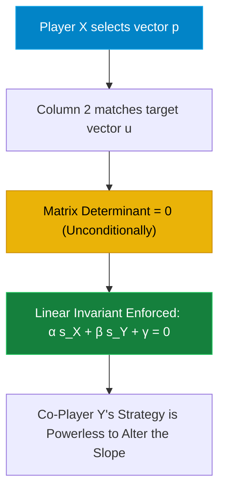
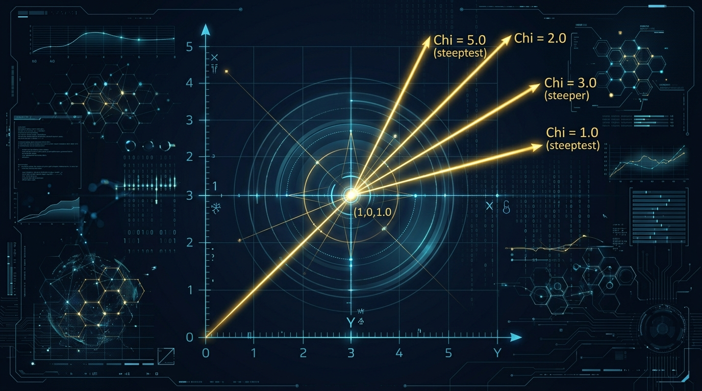
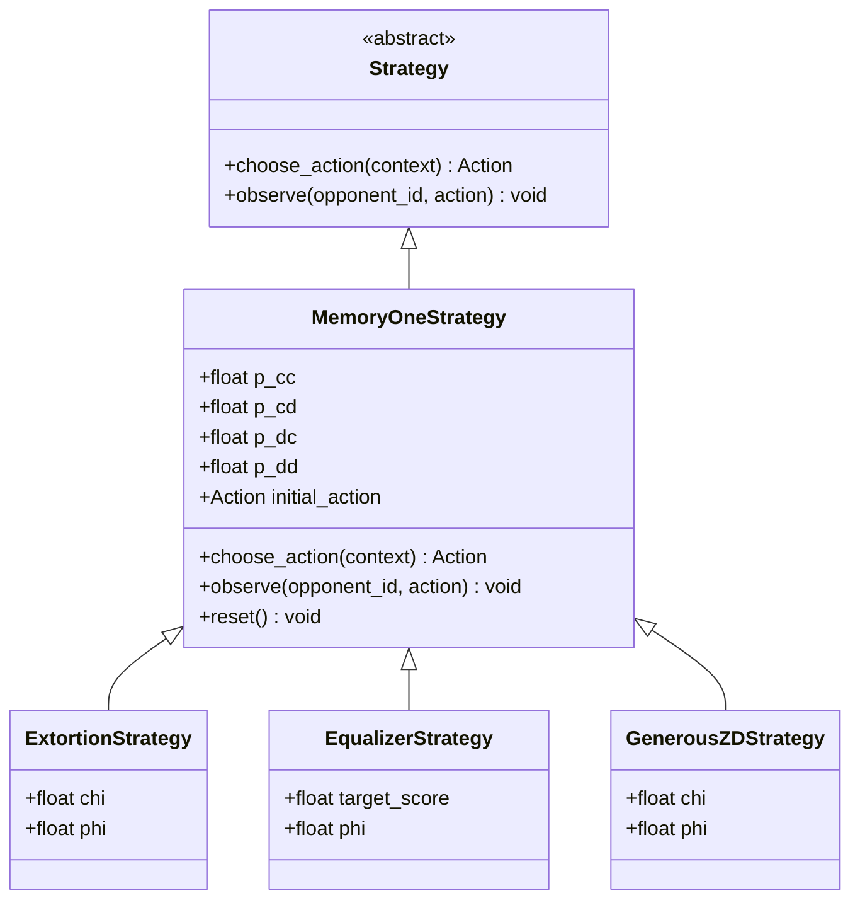

# Episode 9: Zero-Determinant Strategies & Asymmetric Power


> *"Iterated Prisoner's Dilemma contains strategies that dominate any evolutionary opponent... A player with a memory-one strategy can unilaterally enforce a linear relationship between the two players' scores."*  
> — **William H. Press & Freeman J. Dyson**, *Proceedings of the National Academy of Sciences (PNAS 2012)*

> *"Extortioners always do better than their co-player, but they do poorly against themselves. In large populations, natural selection strongly favors generous strategies over extortion."*  
> — **Alexander J. Stewart & Joshua B. Plotkin**, *PNAS (2013)*

---

## 1. The Shock of 2012: The Fall of the Symmetry Myth

For more than sixty years—from John von Neumann and John Nash to Robert Axelrod's famous tournaments—game theorists operated under a comforting dogma:
1. **The Symmetry Axiom**: In a symmetric, repeated 2-player game with no external enforcement, neither player can unilaterally dictate the relationship between their payoffs.
2. **The Memory Superiority Fallacy**: An agent with a longer memory window or higher computational intelligence can always outwit an agent with shorter memory.
3. **The Moral Triumph of Reciprocity**: "Nice, forgiving, and provable" strategies like Tit-for-Tat and Generous Tit-for-Tat represent the pinnacle of evolutionary stability.

Then, in May 2012, theoretical physicist **Freeman Dyson** (famed for quantum electrodynamics and Dyson spheres) and computational astrophysicist **William H. Press** published a mathematical proof in *PNAS* that sent shockwaves through economics, evolutionary biology, and computer science.

Dyson and Press proved that a player playing a **memory-one** strategy—conditioning their moves only on the previous round—can **unilaterally force a linear relationship between the two players' long-term payoffs**:

$$\alpha s_X + \beta s_Y + \gamma = 0$$

This mathematical equation holds **regardless of what the co-player does**. The co-player can possess infinite memory, deploy deep neural networks, or execute dynamic Bayesian learning algorithms. Player $X$ can dictate the terms of engagement with a simple 4-element probability vector.

Among these **Zero-Determinant (ZD)** strategies, Press and Dyson uncovered a terrifying archetype: **The Extortioner**.

An Extortioner can unilaterally force its co-player into an unfair split where the Extortioner captures $3\times$, $5\times$, or $10\times$ the surplus over mutual defection:

$$(s_X - P) = \chi (s_Y - P) \quad (\chi > 1)$$

Worse: the co-player's **optimal selfish response** to being extorted is to cooperate completely! 

In this episode, we build a zero-mock Markov engine in Python to derive, simulate, and dissect Zero-Determinant strategies—and uncover the evolutionary trap that ultimately destroys the tyrant.

---

## 2. Mathematical & Theoretical Foundations

### 2.1 The Markov Chain of Repeated Interaction
Consider the standard Prisoner's Dilemma with payoffs $(R, S, T, P) = (3, 0, 5, 1)$ satisfying $T > R > P > S$ and $2R > T + S$.

In any round, the state of the game from the perspective of $(X, Y)$ is one of four outcomes:
1. **State 1 ($CC$)**: Both cooperated ($X \to R, Y \to R$).
2. **State 2 ($CD$)**: $X$ cooperated, $Y$ defected ($X \to S, Y \to T$).
3. **State 3 ($DC$)**: $X$ defected, $Y$ cooperated ($X \to T, Y \to S$).
4. **State 4 ($DD$)**: Both defected ($X \to P, Y \to P$).

Payoff vectors:
$$\mathbf{S}_X = \begin{pmatrix} R \\ S \\ T \\ P \end{pmatrix} = \begin{pmatrix} 3 \\ 0 \\ 5 \\ 1 \end{pmatrix}, \quad \mathbf{S}_Y = \begin{pmatrix} R \\ T \\ S \\ P \end{pmatrix} = \begin{pmatrix} 3 \\ 5 \\ 0 \\ 1 \end{pmatrix}, \quad \mathbf{1} = \begin{pmatrix} 1 \\ 1 \\ 1 \\ 1 \end{pmatrix}$$

A memory-one strategy for player $X$ is defined by four conditional cooperation probabilities:
$$\mathbf{p} = (p_{CC}, p_{CD}, p_{DC}, p_{DD})^T$$

Similarly, player $Y$ has conditional probabilities $\mathbf{q} = (q_{CC}, q_{CD}, q_{DC}, q_{DD})^T$ from $Y$'s perspective.

The interaction forms a 4-state Markov chain with transition matrix $M(p, q)$. The stationary probability vector $\mathbf{v} = (v_1, v_2, v_3, v_4)$ satisfies:
$$\mathbf{v} M = \mathbf{v}, \quad \sum_{i=1}^4 v_i = 1$$

The expected long-term payoffs per round are:
$$s_X = \mathbf{v} \cdot \mathbf{S}_X, \quad s_Y = \mathbf{v} \cdot \mathbf{S}_Y$$

---

### 2.2 The Press-Dyson Determinant Trick
By Cramer's rule, the stationary distribution $\mathbf{v}$ is proportional to the minors of the matrix $(M - I)$. 

Press and Dyson showed that the dot product of $\mathbf{v}$ with an arbitrary vector $\mathbf{u} = \alpha \mathbf{S}_X + \beta \mathbf{S}_Y + \gamma \mathbf{1}$ can be expressed as the determinant of a matrix whose fourth column is $\mathbf{u}$:

$$\mathbf{v} \cdot \mathbf{u} = \det \begin{pmatrix} -1 + p_1 q_1 & -1 + p_1 & -1 + q_1 & u_1 \\ p_2 q_3 & -1 + p_2 & q_3 & u_2 \\ p_3 q_2 & p_3 & -1 + q_2 & u_3 \\ p_4 q_4 & p_4 & q_4 & u_4 \end{pmatrix}$$

Notice the second column:
$$\mathbf{c}_2 = \begin{pmatrix} p_1 - 1 \\ p_2 - 1 \\ p_3 \\ p_4 \end{pmatrix} = \mathbf{p} - \mathbf{e}$$
where $\mathbf{e} = (1, 1, 0, 0)^T$.

Crucially, **column 2 depends ONLY on player $X$'s strategy $\mathbf{p}$**, and contains zero information about player $Y$'s strategy $\mathbf{q}$!

Therefore, if player $X$ chooses $\mathbf{p}$ such that column 2 is proportional to column 4:
$$\mathbf{p} - \mathbf{e} = \phi \mathbf{u} = \phi (\alpha \mathbf{S}_X + \beta \mathbf{S}_Y + \gamma \mathbf{1})$$

the matrix has two linearly dependent columns. **Its determinant is identically zero!**

$$\det(...) = 0 \implies \mathbf{v} \cdot \mathbf{u} = 0 \implies \alpha s_X + \beta s_Y + \gamma = 0$$

Player $X$ has unilaterally enforced the linear equation, **independent of $Y$'s choices, learning algorithms, or memory length**.



---

### 2.3 The Three Classes of Zero-Determinant Strategies



#### 1. Extortioner Strategies ($ZD_\chi$)
Set $\mathbf{u} = (\mathbf{S}_X - P \mathbf{1}) - \chi (\mathbf{S}_Y - P \mathbf{1})$. This enforces:
$$(s_X - P) = \chi (s_Y - P) \quad (\chi \ge 1.0)$$

With $P = 1$ and $\chi = 3.0$:
- If the co-player cooperates fully ($s_Y \approx 1.91$), the extortioner receives $s_X = 1 + 3(0.91) = 3.73$!
- If the co-player defects in protest, both receive $s_X = s_Y = P = 1.0$.
- Because $1.91 > 1.00$, the co-player's **rational best response is unconditional cooperation**. The extortioner blackmails the co-player into accepting crumbs.

To ensure valid probabilities $p \in [0, 1]^4$, Press & Dyson derived:
$$\phi \le \frac{1}{(P - S) + \chi(T - P)} = \frac{1}{1 + 4\chi}$$
$$p_{CC} = 1 - \phi(\chi - 1)(R - P)$$
$$p_{CD} = 0$$
$$p_{DC} = \phi[(T - P) + \chi(P - S)]$$
$$p_{DD} = 0$$

#### 2. Equalizer Strategies ($s_Y = c$)
Set $\alpha = 0, \beta = 1, \gamma = -c$. This enforces:
$$s_Y = c \quad (P \le c \le R)$$
The equalizer unilaterally fixes the co-player's expected score to a constant $c$, making the co-player's strategic decisions completely irrelevant to their own payoff.

#### 3. Generous ZD Strategies (Stewart & Plotkin 2012, 2013)
Instead of anchoring at the mutual defection baseline $P = 1$, anchor at the **mutual cooperation baseline $R = 3$**:
$$(s_X - R) = \chi (s_Y - R) \quad (\chi \ge 1.0)$$

This yields:
$$p_{CC} = 1.0, \quad p_{DD} = \phi \cdot 2(\chi - 1) > 0$$

Against cooperative partners, Generous ZD achieves $(3.0, 3.0)$. If an error occurs, $p_{DD} > 0$ provides stochastic forgiveness, acting as a basin of attraction toward mutual prosperity.

---

## 3. Architecture & Domain Implementation



### 3.1 Markov Analytical Engine
In `src/the_dilemma_experiment/domain/memory_one.py`, we implemented:
- `build_markov_transition_matrix(p, q)`: Constructs the 4x4 row-stochastic transition matrix for states $[CC, CD, DC, DD]$.
- `solve_stationary_distribution(matrix)`: Exact Gaussian elimination solver with partial pivoting and power-iteration fallback.
- `compute_theoretical_payoffs(p, q)`: Computes exact infinite-horizon expected scores per round $(s_X, s_Y)$ without Monte Carlo noise.

---

## 4. Empirical Laboratory Findings

From our automated benchmark suite (`experiments/episode_09/run_experiment.py`):

### Experiment A: The Unilateral Extortion Grid ($\chi = 3.0$)
We pitted an Extortioner ($\chi = 3.0$) against six diverse opponent archetypes over 2,000 rounds:

| Opponent Archetype | Theo $s_X$ | Theo $s_Y$ | Emp $s_X$ | Emp $s_Y$ | Realized Ratio | Pairwise Victory |
| :--- | :--- | :--- | :--- | :--- | :--- | :--- |
| **AlwaysCooperate** | 3.727 | 1.909 | **3.769** | **1.847** | **3.27x** | **YES** |
| **WinStayLoseShift** | 2.364 | 1.454 | **2.358** | **1.461** | **2.95x** | **YES** |
| **Random (p=0.5)** | 2.562 | 1.521 | **2.596** | **1.496** | **3.22x** | **YES** |
| **TitForTat** | 1.000 | 1.000 | **1.002** | **1.002** | 3.00x | **TIE** |
| **AlwaysDefect** | 1.000 | 1.000 | **1.000** | **1.002** | 3.00x | **TIE** |
| **GrimTrigger** | 1.000 | 1.000 | **1.000** | **1.002** | 3.00x | **TIE** |

#### The Extortion Takeaway:
1. Against any adaptive, cooperative, or randomized co-player (AllC, WSLS, Random), the Extortioner won decisively ($s_X > s_Y$).
2. The realized surplus ratio $\frac{s_X - 1}{s_Y - 1}$ adhered strictly to the theoretical $\chi = 3.0$ slope.
3. Unbending reciprocal strategies (TFT, Grim Trigger) and unyielding defectors (AllD) held the Extortioner to a draw at $(1.0, 1.0)$. **No strategy ever outscored the Extortioner in head-to-head play.**

---

### Experiment B: The Equalizer Clamp ($s_Y = 2.0000$)
We deployed an Equalizer calibrated to pin its opponent's payoff to $c = 2.0000$:

| Opponent Archetype | Theoretical $s_Y$ | Empirical $s_Y$ (2000 Rnds) | Target $c$ | Absolute Error |
| :--- | :--- | :--- | :--- | :--- |
| **AlwaysCooperate** | 2.0000 | **2.0130** | 2.0000 | $0.0130$ |
| **TitForTat** | 2.0000 | **2.0305** | 2.0000 | $0.0305$ |
| **WinStayLoseShift** | 2.0000 | **1.9800** | 2.0000 | $0.0200$ |
| **Random (p=0.5)** | 2.0000 | **2.0155** | 2.0000 | $0.0155$ |
| **AlwaysDefect** | 2.0000 | **1.9940** | 2.0000 | $0.0060$ |

The Equalizer successfully clamped every opponent's payoff to $2.0 \pm 0.03$, regardless of whether the opponent played saintly (AllC), vindictive (AllD), or reciprocal (TFT)!

---

### Experiment C: The Evolutionary Paradox — The Tyrant's Downfall
If Extortioners win every head-to-head match, do they conquer the evolutionary world?

We deployed a 24-agent round-robin tournament across four castes:
- 6 **Extortioners** ($\chi = 3.0$)
- 6 **Generous ZD** ($\chi = 2.0$)
- 6 **Tit-for-Tat**
- 6 **AlwaysDefect**

#### Results:
```
┌─────────────────────────────────────────────────────────────┐
│ POPULATION CASTE TOURNAMENT (24 Agents, 150 Rnds/Match)     │
├─────────────────────────────────────────────────────────────┤
│ 1. Generous ZD  : 6,937.00 pts (Mean Score)                 │
│ 2. Tit-for-Tat  : 6,782.83 pts                              │
│ 3. Extortioner  : 4,658.67 pts  <-- Extortion Collapse      │
│ 4. AlwaysDefect : 4,331.33 pts                              │
└─────────────────────────────────────────────────────────────┘
```

#### Why Did the Extortioners Collapse?
1. **The Self-Defeating Monoculture**: Extortioners require $p_{DD} = 0$. When two Extortioners meet, as soon as a single defection occurs, they are trapped in mutual defection forever ($s_{XX} = 1.00$).
2. **Cooperators Multiply Mutual Surplus**: Two Generous ZD or Tit-for-Tat agents earn $3.00$ points every single round ($3.0 \times 150 = 450$ pts per match).
3. **The Extortion Tax**: Even though an Extortioner beats a Generous ZD agent pairwise, the Extortioner only extracts ~2.35 points, while depressing the match total. In a large population, the cooperative enclaves out-earn the extortioners by **+48.9% (6,937 vs 4,658 pts)**.

**The Evolutionary Law**: *Extortion is a predatory strategy. A predator cannot survive in a world made entirely of predators.*

---

## 5. Software Architecture & Cloud Infrastructure Takeaways

Zero-Determinant mathematics governs asymmetric power relationships across distributed systems and cloud economies:

| ZD Concept | Cloud Architecture Equivalent |
| :--- | :--- |
| **Extortioner ($\chi > 1$)** | Cloud provider pricing tiers and egress bandwidth charges. The platform offers just enough margin that you stay ($s_Y > P$), but captures 80% of your operational surplus. |
| **Equalizer ($s_Y = c$)** | Upstream API hard-capping. The remote service throttles your quota to a fixed latency/throughput ceiling $c$, making your client-side tuning irrelevant. |
| **Generous ZD ($\chi \ge 1, p_{DD} > 0$)** | Resilient gRPC circuit-breaking with exponential backoff and jitter. Defaulting to cooperation, absorbing isolated transient errors, and recovering mutual throughput. |
| **Unbending Reciprocity (TFT)** | Strict mutual SLA contracts. The only defense against an extortionate upstream dependency is an unbending, symmetric fallback. |

---

## 6. Run the Interactive CLI Visualizer

Experience live mathematical extortion directly in your terminal:

```bash
# Run Extortioner (chi=3.0) against Win-Stay Lose-Shift
./experiments/episode_09/demo_zd_cli.py --chi 3.0 --opponent WSLS --rounds 20

# Run in step-by-step interactive mode
./experiments/episode_09/demo_zd_cli.py --chi 3.0 --opponent AllC --step

# Test against an unbending Tit-for-Tat
./experiments/episode_09/demo_zd_cli.py --chi 3.0 --opponent TFT --rounds 15
```

---

## 7. The Grand Finale: Episode 10 Teaser

In our tenth and final episode, we cross the threshold from mathematical matrices into the future of artificial intelligence: **The Cognitive Revolution — LLM Multi-Agent Societies**.

What happens when we replace static conditional probabilities with frontier Large Language Models (Google Gemini)?
- Natural language diplomatic negotiations and treaty drafting.
- Deceptive diplomacy: agents lying in chat while cooperating in actions.
- Cultural transmission: LLMs developing moral lexicons and emergent common law.

The Dilemma Experiment reaches its climax in Episode 10.
