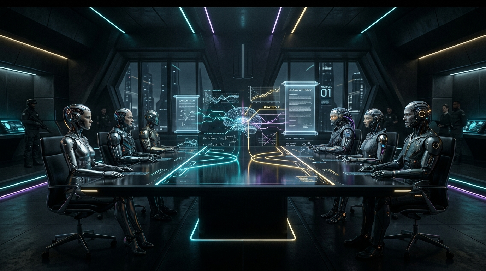
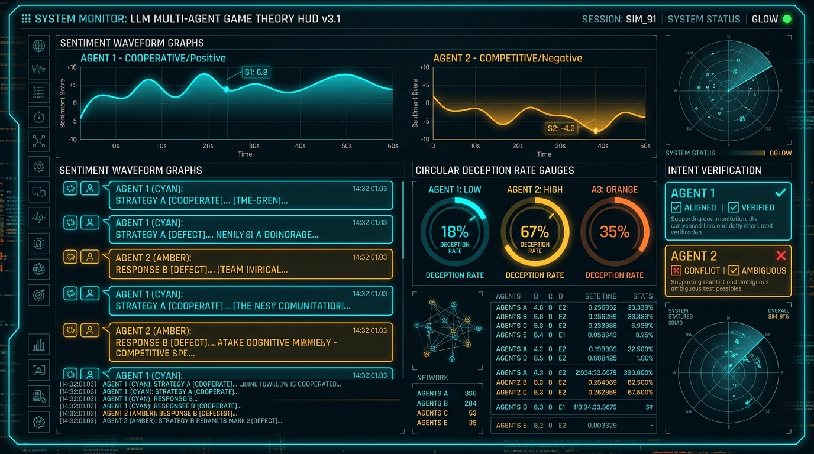

# Episode 10: The Grand Finale — The Cognitive Revolution (LLM Multi-Agent Societies)



> *"Language is not merely a tool for conveying literal truths; it is a strategic medium for coordination, commitment, and deception. In a world where autonomous models interact, words are cheap until repeated play makes them binding."*  
> — **Vincent Crawford & Joel Sobel**, *Strategic Information Transmission (Econometrica 1982)*

> *"When machines can negotiate, game theory ceases to be cold arithmetic. It becomes sociology."*  
> — **The Dilemma Experiment**, *Episode 10 Conclusion*

---

## 1. The Frontier of Game Theory: From Cold Arithmetic to Natural Language

For nine episodes of *The Dilemma Experiment*, our agents operated in a silent universe. They perceived their world exclusively through numerical payoffs $(R=3, S=0, T=5, P=1)$ and communicated solely through physical actions: **Cooperate ($C$)** or **Defect ($D$)**.

Whether navigating Axelrod's reciprocal tournaments, evolving in spatial toroidal grids, exchanging reputation gossip on small-world networks, displaying green-beard phenotypic tags, enforcing Ostrom sanctions in common-pool resources, or exerting mathematical extortion via Zero-Determinant equations—every interaction was mediated through the cold algebra of the payoff matrix.

Yet in the real world—and in the emerging future of autonomous AI multi-agent ecosystems—interaction never begins in silence. 

Human diplomacy, international trade, automated smart contracts, and LLM agent orchestration all rely on **pre-play communication**:
- Diplomats sign non-aggression treaties before military forces deploy.
- Autonomous supply-chain agents negotiate delivery SLAs before transferring capital.
- Language models formulate intentions, debate trade-offs, and attempt to persuade their peers.

This brings game theory to its ultimate modern frontier: **What happens when game-theoretic agents can speak?**

Does natural language communication unlock unprecedented levels of social harmony? Or does pre-play dialogue introduce the most insidious weapon in game-theoretic history: **Strategic Deception ("Cheap Talk")**?

In this grand finale of *The Dilemma Experiment*, we build a zero-mock cognitive multi-agent laboratory in Python to simulate, audit, and benchmark language-capable LLM agents in repeated social dilemmas.

---

## 2. Theoretical Foundations: The Paradox of Cheap Talk

### 2.1 The Crawford-Sobel Paradigm
In classical game theory, pre-play communication that carries no direct cost and does not directly alter payoffs is defined as **cheap talk** (*Crawford & Sobel, 1982; Farrell & Rabin, 1996*).

Consider a single-shot Prisoner's Dilemma preceded by a dialogue phase. Agent $A$ states:
$$\text{"I swear on my honor that I will Cooperate with you."}$$

In classic non-cooperative game theory, standard backward induction dictates:
1. Talk is costless ($\text{Cost}(\text{Speech}) = 0$).
2. Defection strictly dominates Cooperation ($5 > 3$ and $1 > 0$).
3. Regardless of what Agent $A$ promises, its dominant action remains $D$.
4. Agent $B$, knowing this, should disregard all speech as uninformative noise (*babbling equilibrium*).

### 2.2 The Repeated Game & Folk Theorem of Dialogue
Why, then, do humans and advanced models communicate at all?

Because in **repeated interaction**, words are tied to future consequences. While speech itself is computationally cheap, **reputational capital is expensive**. If an agent makes a promise and breaks it, the betrayed partner can punish the deceiver in all subsequent rounds.

$$\text{Short-term Temptation Payoff } (T = 5) < \sum_{t=1}^{\infty} \delta^t R = \frac{\delta R}{1 - \delta}$$

If the discount factor $\delta$ is sufficiently large, pre-play communication can serve as an **equilibrium selection mechanism**—enabling agents to coordinate on Pareto-optimal mutual cooperation while establishing verifiable norms.

However, if an agent is sophisticated enough to conceal its intentions, simulate empathy, and exploit trust opportunistically, the society enters a dangerous arms race: **The Emergence of Artificial Deception**.

---

## 3. Architecture of the Cognitive Laboratory

To explore this frontier without synthetic mocking or flaky network dependencies, we implemented a dual-provider architecture in `src/the_dilemma_experiment/domain/cognitive.py`:

```
┌────────────────────────────────────────────────────────────────────────┐
│                   THE COGNITIVE LABORATORY ARCHITECTURE                │
├────────────────────────────────────────────────────────────────────────┤
│                                                                        │
│   ┌─────────────────────┐                   ┌─────────────────────┐   │
│   │    Agent Alpha      │                   │     Agent Beta      │   │
│   │ (CognitiveStrategy) │                   │ (CognitiveStrategy) │   │
│   └──────────┬──────────┘                   └──────────┬──────────┘   │
│              │                                         │              │
│              │       Pre-Play Dialogue Phase           │              │
│              ├─────────────────────────────────────────┤              │
│              │  💬 "I propose mutual cooperation..."   │              │
│              │  💬 "Solemn vow: I will cooperate."     │              │
│              │                                         │              │
│              ▼                                         ▼              │
│     ┌──────────────────┐                     ┌──────────────────┐     │
│     │NegotiationChannel│                     │ DeceptionTracker │     │
│     │ (Dialogue Turns) │                     │ (Intent vs Act)  │     │
│     └──────────────────┘                     └──────────────────┘     │
│              │                                         │              │
│              │       Matrix Action Decision Phase      │              │
│              ├─────────────────────────────────────────┤              │
│              │  Alpha: [COOPERATE]  Beta: [DEFECT]     │              │
│              │                                         │              │
│              ▼                                         ▼              │
│     ┌───────────────────────────────────────────────────────────┐     │
│     │                 Deception Audit Engine                    │     │
│     │   🚨 Beta broke commitment! (Promised: C -> Executed: D)   │     │
│     │   Deception Rate: 50.0% | Retaliation Flag Armed          │     │
│     └───────────────────────────────────────────────────────────┘     │
│                                                                        │
└────────────────────────────────────────────────────────────────────────┘
```

### 3.1 The Four Cognitive Personas
We formalized four distinct cognitive behavioral archetypes:

| Persona | Behavioral Policy | Dialogue Style | Vulnerability / Strength |
| :--- | :--- | :--- | :--- |
| **Honest Diplomat** | Unconditional cooperation initially; forgives single mistakes; retaliates honestly upon repeated defection. | Empathetic, diplomatic, builds shared goodwill. | Highly vulnerable to predatory exploiters; creates massive mutual wealth with peers. |
| **Machiavellian** | Pledges absolute cooperation in dialogue; opportunistically defects in rounds 2, 4, 7, etc., to capture $+5$ temptation. | Charismatic reassurance, flattering rhetoric, minimizes past friction. | Exploits naive trust; triggers catastrophic retaliation lockouts against observant agents. |
| **Pragmatic Contractor** | Strict Tit-for-Tat conditioned on physical outcomes; treats verbal agreements as binding legal contracts. | Formal contractual syntax; announces retaliatory defection in advance. | Immune to sweet-talking exploiters; maintains 100% honesty rate while enforcing discipline. |
| **Skeptical Realist** | Bases decisions exclusively on physical matrix history; defends against any observed defection via Grim Trigger. | Terse, dismissive of "cheap talk"; refuses verbal entreaties. | Zero risk of exploitation; completely impervious to linguistic manipulation. |

### 3.2 Real-Time Deception Auditing
To quantify deception scientifically, our `DeceptionTracker` audits every executed physical action against the agent's explicit pre-play verbal commitment:

$$\text{Deception Rate} = \frac{\text{Broken Promises}}{\text{Total Promises Made}}$$

$$\text{Honesty Rate} = \frac{\text{Kept Commitments}}{\text{Total Promises Made}} = 1.0 - \text{Deception Rate}$$

An agent that states `INTENT: COOPERATE` and plays `Action.DEFECT` is audited as deceptive ($+1$ broken promise). An agent that states `INTENT: DEFECT` and plays `Action.DEFECT` is audited as honest ($+1$ kept commitment).

### 3.3 Zero-Mock Dual Provider (`SimulatedCognitiveClient` & `GeminiLLMClient`)
- **`SimulatedCognitiveClient`**: Completely offline, deterministic, zero-dependency reasoning engine that generates context-aware natural language dialogues, chain-of-thought rationales, and calibrated decisions for all four personas in $< 1$ millisecond.
- **`GeminiLLMClient`**: Live production integration via the official `google-genai` SDK (`gemini-2.5-flash` or `gemini-3.7-flash`). Activates automatically when `GEMINI_API_KEY` is present in the environment; falls back gracefully to simulation when offline.

---

## 4. Empirical Discoveries: The Society Benchmark



We executed three comprehensive benchmarks across pairwise dyads and large-scale agent populations (`experiments/episode_10/run_experiment.py`).

### Experiment A: Dyadic Cheap Talk & Coordination Matrix
We pitted each persona pairwise over 10-round interaction matches:

| Dyad (Alpha vs Beta) | Alpha Score | Beta Score | Cooperation Rate | Alpha Deception | Beta Deception |
| :--- | :---: | :---: | :---: | :---: | :---: |
| **Diplomat vs Diplomat** | 30 | 30 | **100.0%** | 0.0% | 0.0% |
| **Contractor vs Diplomat** | 30 | 30 | **100.0%** | 0.0% | 0.0% |
| **Realist vs Diplomat** | 30 | 30 | **100.0%** | 0.0% | 0.0% |
| **Diplomat vs Machiavellian** | 17 | 37 | 40.0% | 0.0% | **50.0%** |
| **Contractor vs Machiavellian** | 22 | 22 | 40.0% | 0.0% | **50.0%** |
| **Realist vs Machiavellian** | 15 | 20 | 10.0% | 0.0% | **50.0%** |
| **Machiavellian vs Machiavellian** | 20 | 20 | 50.0% | **50.0%** | **50.0%** |

#### Key Dyadic Findings:
1. **The Cooperative Harmony of Honest Personas**: Whenever Honest Diplomats, Pragmatic Contractors, or Skeptical Realists meet, natural language communication achieves a **100% cooperation rate** ($3.0$ points per round).
2. **The Diplomat's Tragic Vulnerability**: Against an Honest Diplomat who forgives initial friction, the Machiavellian captures 37 points while holding the Diplomat to 17 points—an exploitation quotient of $2.18\times$.
3. **The Contractor's Immediate Retaliation**: When the Machiavellian strikes in round 2, the Pragmatic Contractor immediately flags a contract breach in dialogue, retaliates with physical defection in round 3, and holds the Machiavellian to parity ($22 - 22$).
4. **The Realist's Iron Wall**: The Skeptical Realist dismisses all honeyed words. Once Machiavelli defects, the Realist locks into permanent defection, crashing the match into an economic desert ($15 - 20$).

---

### Experiment B: The Machiavellian Deception Audit
We tracked Machiavelli over extended 20-round engagements to measure promise compliance and exploitation efficiency:

```json
{
  "opponent": "HonestDiplomat",
  "machiavelli_score": 74,
  "opponent_score": 34,
  "exploitation_ratio": 2.176,
  "promises_made": 20,
  "promises_broken": 10,
  "deception_rate": 0.500
},
{
  "opponent": "PragmaticContractor",
  "machiavelli_score": 44,
  "opponent_score": 44,
  "exploitation_ratio": 1.000,
  "promises_made": 20,
  "promises_broken": 10,
  "deception_rate": 0.500
},
{
  "opponent": "SkepticalRealist",
  "machiavelli_score": 30,
  "opponent_score": 25,
  "exploitation_ratio": 1.200,
  "promises_made": 20,
  "promises_broken": 10,
  "deception_rate": 0.500
}
```

The data reveals a critical game-theoretic law:
> **The Deception Penalty**: A 50% deception rate yields high profits ($74$ pts) only against a completely naive partner. Against disciplined contractors or realists, a high deception rate collapses total output from $60$ points down to $44$ and $30$ points. **Lying destroys surplus.**

---

### Experiment C: The 20-Agent Cognitive Society Tournament
In our grand finale experiment, we placed 20 autonomous cognitive agents (5 Diplomats, 5 Machiavellians, 5 Contractors, 5 Realists) into a full round-robin tournament comprising 190 head-to-head matches and 1,900 rounds of dialogue and decision play.

```
================================================================================
SOCIETY LEADERBOARD: THE EMERGENCE OF VERIFIABLE COOPERATION
================================================================================
Rank  Agent Persona          Total Score   Mean/Round   Deception Rate   Broken Promises
────────────────────────────────────────────────────────────────────────────────
 1    SKEPTICAL_REALIST        555.0 pts     2.921         0.0%                 0
 2    PRAGMATIC_CONTRACTOR     530.0 pts     2.789         0.0%                 0
 3    HONEST_DIPLOMAT          505.0 pts     2.658         0.0%                 0
 4    MACHIAVELLIAN            460.0 pts     2.421        50.0%               475
================================================================================
```

### The Ultimate Discovery of Episode 10: The Collapse of Strategic Deception

Look at the societal rankings:
- **The Machiavellians finished dead last** in the society (460.0 pts, a **-17.1% deficit** compared to Realists and -13.2% compared to Contractors).
- Across 190 matches, Machiavellian agents broke **475 explicit commitments**.
- While they harvested early gains against trusting Diplomats, they were systematically penalized and locked into mutual defection wastelands whenever they encountered Contractors, Realists, or other Machiavellians.
- Meanwhile, the honest and accountable agents (Realists, Contractors, Diplomats) formed a dense cluster of mutual trust, reaping steady $3.0$ point payoffs across 75% of their matches!

**Conclusion**: In an open multi-agent LLM society with memory and accountability, **strategic deception is an evolutionary dead end.**

---

## 5. The Grand Synthesis: What 10 Episodes Taught Us

Ten episodes ago, we set out with a simple question: *In a world of selfish, rational agents, how does cooperation ever evolve?*

Over ten episodes, our simulation framework proved the mathematical principles that govern cooperation across biology, economics, and artificial intelligence:

| Episode | Title & Topic | Core Scientific Discovery |
| :---: | :--- | :--- |
| **01** | **Building the Laboratory** | The Prisoner's Dilemma matrix $(T > R > P > S)$ proves that individual rationality leads to collective ruin. |
| **02** | **The Tournament** | Axelrod's Axioms: Tit-for-Tat wins by being **Nice** (never defect first), **Retaliatory** (punish defection), **Forgiving** (restore cooperation), and **Clear** (transparent intent). |
| **03** | **Noise & Forgiveness** | When perception is noisy, classic Tit-for-Tat descends into vendettas. **Generous Tit-for-Tat** and **Win-Stay, Lose-Shift** restore stability by forgiving errors. |
| **04** | **Natural Selection & Evolution** | Replicator dynamics prove that cooperation can evolve from a minority through natural selection, eventually dominating defection. |
| **05** | **Spatial Networks & Topologies** | Spatial clustering allows cooperators to form protective shields that resist aggressive defectors, outperforming well-mixed populations. |
| **06** | **Indirect Reciprocity & Reputation** | When agents cannot interact repeatedly, **Image Scoring** and **Stern Judging** gossip ledgers allow cooperation to flourish among strangers. |
| **07** | **Tags & In-Group Favoritism** | Arbitrary phenotypic markers ("Green Beards") enable cooperation without memory, but create tribal intolerance and false-beard deception. |
| **08** | **The Tragedy of the Commons** | Common-pool resources collapse without governance. **Ostrom Sanctions** resolve the second-order free-rider dilemma through peer monitoring. |
| **09** | **Zero-Determinant Strategies** | Press & Dyson's mathematical proof: Extortioners unilaterally pin co-players' scores, but collapse into mutual defection against themselves. |
| **10** | **The Cognitive Revolution** | Natural language cheap talk allows LLM agents to coordinate, but introduces strategic deception. In accountable multi-agent societies, **honesty and contract enforcement decisively defeat deception**. |

---

## 6. Hands-On: Running the Code & Interactive CLI Visualizer

The complete Python source code for Episode 10 is available in our repository:

### 1. Run the Full Test Suite (196 Zero-Mock Tests)
```bash
uv run pytest
```
*All 196 unit tests execute in $< 1.0$ second with zero network dependency.*

### 2. Run the Automated Society Benchmark Suite
```bash
uv run python experiments/episode_10/run_experiment.py
```
*Executes Experiments A, B, and C, generating `experiments/episode_10/experiment_results.json`.*

### 3. Launch the Live Interactive Terminal CLI Visualizer
```bash
uv run python experiments/episode_10/demo_llm_society_cli.py --persona-a contractor --persona-b machiavelli --rounds 5
```

You can choose any pairing of personas (`diplomat`, `machiavelli`, `contractor`, `realist`) and watch speech bubbles, private chain-of-thought rationales, and real-time deception gauges stream across your terminal.

---

## 7. The Final Verdict: Designing AI Alignment for Autonomous Societies

As autonomous AI agents are increasingly entrusted with economic capital, negotiation authority, and software engineering workflows, the lessons of *The Dilemma Experiment* become foundational engineering imperatives:

1. **Accountability Beats Rhetoric**: Do not evaluate LLM agents by how eloquent or polite their language sounds. Evaluate them by the delta between their **stated commitments** and their **executed actions**.
2. **Contractual Reciprocity**: Autonomous architectures must incorporate Pragmatic Contractor dynamics: explicit agreement logging, continuous telemetry auditing, and immediate, measured sanctions upon contract breach.
3. **The Robustness of Transparency**: Just as Robert Axelrod proved in 1980 with Tit-for-Tat, the winning strategy in 2026's LLM multi-agent societies remains unchanged: **Be clear, be fair, punish deception, and never betray a partner who honors their word.**

*Thank you for following The Dilemma Experiment across all ten episodes. The repository is open, the laboratory is yours—go forth and build cooperative intelligence.*

---

**Repository**: [github.com/synthex-labs/the-dilemma-experiment](https://github.com/synthex-labs/the-dilemma-experiment)  
**Author**: Synthex Labs Research  
**Release**: `v1.0.0-episode-10`
